My original working title was "The Character of Cities". Most of what I had written before were pieces about the natural scenery of the Alps; this time, I wanted to feel the cities. In what I imagined before setting off, I would sit in a café on the corner of some square, its awning jutting out, a stone monument in the middle of the square, watching people cut across it on the diagonal.

The trip was planned and carried out successfully. When it ended, my bank card and passport were still with me, and I had good weather more than half the time — that alone should have made me grateful enough. Yet I didn't feel happy enough; I even felt a little worn out. It seems I hadn't learned how to appreciate the encounters along the way. After ten days without looking at a computer my neck still ached; the aggression stirred up by feelings of superiority and frustration still shot out uncontrollably, like a half-mastered Six Meridians Divine Sword from a wuxia novel; and the moment I sat back down at my desk I automatically crossed my legs again, as if nothing had changed. I probably wouldn't manage any real observations on "the character of cities" either.

I thought of some other subtitles,\
---"What I Think About When I Travel",\
---"Me, as a Traveller",\
---"My Chat Logs with AI".

Whatever the case, I always end up writing something. I enjoy the process — a comfortable font size and line spacing, like a ruminant that gets to count a Michelin meal as half price because it eats it twice; the river of memory flows slowly from its source, and the things it touches light up one lamp after another. While preparing and travelling, I asked AI about many different things: {Bavaria and Saxony, the prince-electors}, {rum, burek and herring}, {Art Nouveau, the crown jewel of Sweden's Nationalmuseum}, {the populations of Vienna and Tallinn, fish pollution in the Baltic}, {Andersen's fairy tales and an opera-goer's guide to Carmen} …. It's like picking up a bunch of grapes: the trip is the stem, and on that stem hang the fruits.

So let's call it a Travel Hash. "Hash" is a word I picked up in Denmark — something like a hodgepodge stew. Or call it a Travel Scout: a rough, quick reconnaissance. This was my first trip around Europe, a chance to get a first impression of how wide the world is.

Early — 5:20 — I left Ägeri on the 601 bus to Zug. Since it was my first time finding the FlixBus coach station, I decided to leave early; the bus from Zurich to Munich departed at 7 a.m. Even this early, the bus was already fairly full; one man carried a big Lidl bag and looked like he was on his way to work. On the station platform, a little girl was dancing about beside her suitcase, beside herself with excitement. I thought: people may only travel a few times a year, so running into others who happened to choose the same day to set out felt like sharing in a small honour.

A colleague suggested I take the bus to Munich, since Deutsche Bahn is often late and the bus actually ends up faster. I bought the ticket in advance: Zurich to Munich, 20 euros. This trip was a little ambitious. I planned to set out from Zurich for Dresden — a city that in my imagination was bound up with gleaming golden brass and massive stone — then head north all the way to Flensburg at the very top of the German map, on to Copenhagen in Denmark and Stockholm in Sweden, then fly to the eastern shore of the Baltic for Riga in Latvia and Tallinn in Estonia, then go south to Vienna, and come back into Switzerland from the east.

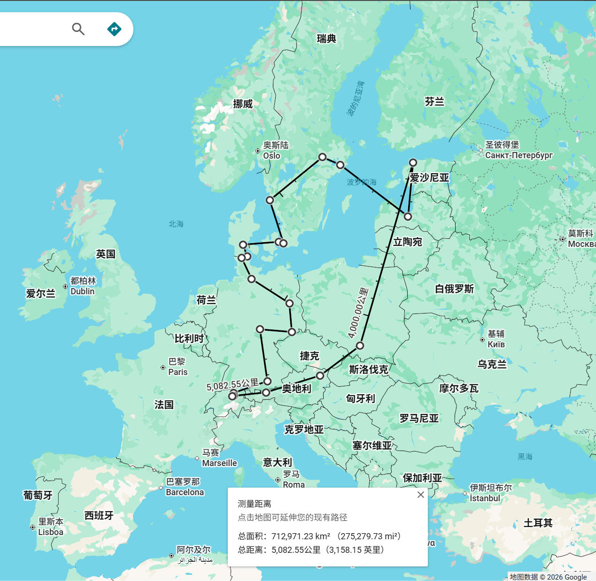{: style="width:57.99%"}

Planning the route is half the joy of travel. When I write a string of dates, place names and times on paper, take stock of what to bring — euro cash, medicine, toiletries, plug adapters — and strike out a few earlier options with a slash, <u>making choices, practising trade-offs, full of ambition and quietly content, my journey has already begun ahead of physical time</u>.

Germany is made up of 16 federal states, and the whole map looks like a dress. Munich in the south is the capital of Bavaria, called Bayern in German. After the Second World War, many companies and scientific and technical talents moved south from Berlin and the east to escape the Soviet occupation zone, which drove Bavaria's transformation from a traditional agricultural state; today it is a technology powerhouse, home to BMW, Audi, Siemens and others. The blue-and-white BMW roundel is said to come from Bavaria's blue-and-white checkered flag; BMW (Bayerische Motoren Werke AG) translates as "Bavarian Engine Works". \[1\] Earlier still, in 1623, Bavaria was elevated from a duchy to an electorate as a reward for helping the emperor put down a rebellion. \[2\] In Munich today you can still see the rich collections of the Residenz and its expansive palace gardens.

In October, autumn tinted the distant hills, and white mist hung over the green fields nearby. The bus passed Lake Constance, and an hour or two later we reached Munich. Almost every European city comes with an area called the Old Town as standard: cobbled pedestrian streets, and a square–palace–church–town-hall set. Oktoberfest had just ended; the festival is said to have begun as a celebration of a marriage between the Bavarian and Saxon royal houses, a big open-air feast to which the townspeople were invited. Munich's drinking places are called beer gardens; the basic elements are long wooden tables and benches on an open lawn, and the one-litre Maß glass. At the heart of the Old Town is Marienplatz, where the Gothic New Town Hall, its windows dressed with greenery, is a real eye-catcher. My friend told me that at 11 and 12 o'clock the figures in the clock tower perform a knights' tournament and the street celebration marking the end of the Black Death. Bavaria's famous foods are roast pork knuckle, white sausage and beer. But with bad luck, over a euro or two of tip, you may have to watch out for a waiter in Bavarian plaid turning from Bavarian into Barbarian. After the meal my friend took me for a walk in the English Garden, named after the naturalistic style of English landscape gardens — a long strip of green along the Isar, where locals often go river surfing.

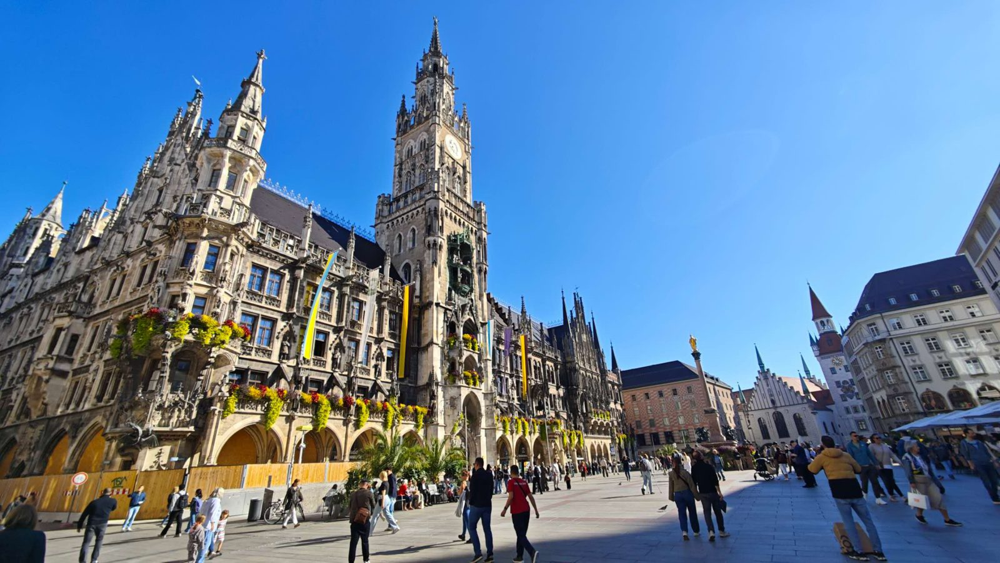{: style="width:50%"}
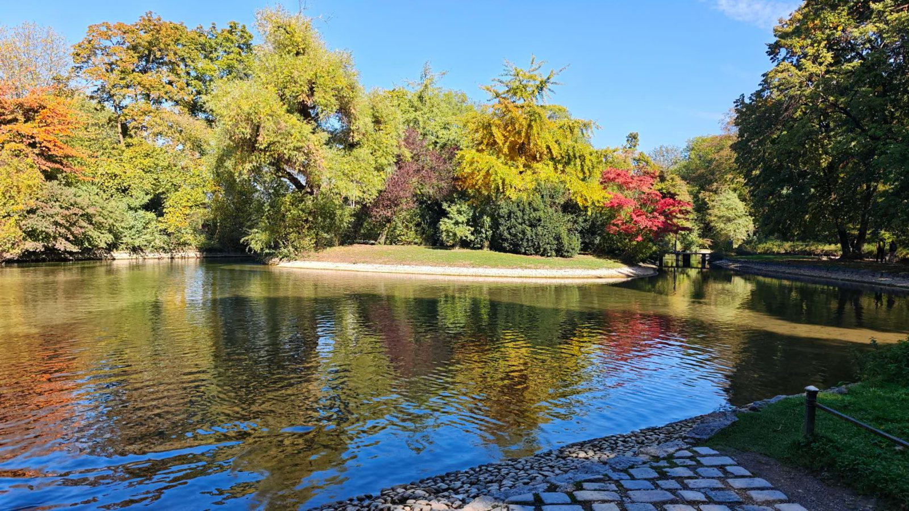{: style="width:50%"}

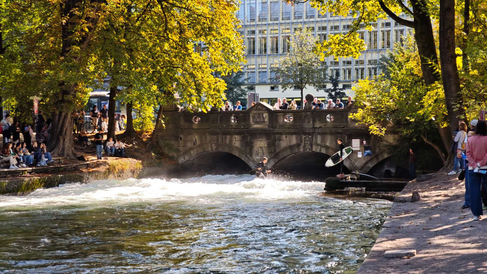{: .float-left style="width:50%"}

After saying goodbye to my friend, I headed to another "princely state", Saxony, whose capital is Dresden. Saxony was a founding member of the electorates, with an even older pedigree than Bavaria. Augustus — Duke of Saxony from the House of Wettin and King of Poland, nicknamed "the Strong" for snapping horseshoes with his bare hands — was a devoted fan of Louis XIV of France, and built lavishly here, transplanting the model of Versailles to the banks of the Elbe. Bavaria's royals, admirers of classical Greek culture, made Munich into the "Athens on the Isar" (Isarathen); Saxony's royals strove to turn Dresden into the "Florence on the Elbe". Besides splendid Baroque palaces, treasure collections and royal gardens, Augustus also funded an alchemist who cracked the secret of making porcelain, and Meissen (Meißen), a small town north of Dresden, became the porcelain capital of Europe.

The train went north from Munich past Nuremberg, then east via Leipzig, and it was evening by the time I reached Dresden. Chinese railway stations are usually named North Station, East Station, while in Europe trains often run right through the city, and a city often has several stations; Dresden, for example, has the main station, Mitte and Neustadt. I got off at Dresden-Neustadt, on the north bank of the Elbe; the south bank is the Old Town. Although it is called the "New Town", its core was laid out in 1732: an extremely wide tree-lined avenue runs straight from the Golden Rider statue by the river to Albertplatz, a perspective of geometric order and beauty. Just north of the square lies a food quarter full of everyday life. When an injera the size of a washbasin was set on the table with a warm "Bitte schön", a particular feeling of being a traveller was stirred in that moment. I tried an Eritrean restaurant — Eritrea is a country in North Africa on the Red Sea — where colourful stews and vegetables were spread over a soft, spongy, slightly sour flatbread. The traditional way to eat it is without any cutlery: you tear off pieces of the bread and pinch up the stews with your hand. Hostels seem very popular in Europe; travellers make up their own beds with sheets and pillowcases, and experienced guests bring a small padlock for the lockers. Everything was clean. After settling in I went out for a stroll. What is European nightlife like? Unlike the Berlin techno and subcultures I had read about, Dresden's felt more like a student quarter. Bikes with pannier bags — years ago, after evening study hall, I too rode through crossroads with traffic lights like that; young people leaning against graffiti-covered wooden boards on the street; the atmosphere and crowds of the neighbourhood bars. A friend asked my impression of Dresden, and I answered: many students alive — living, breathing people.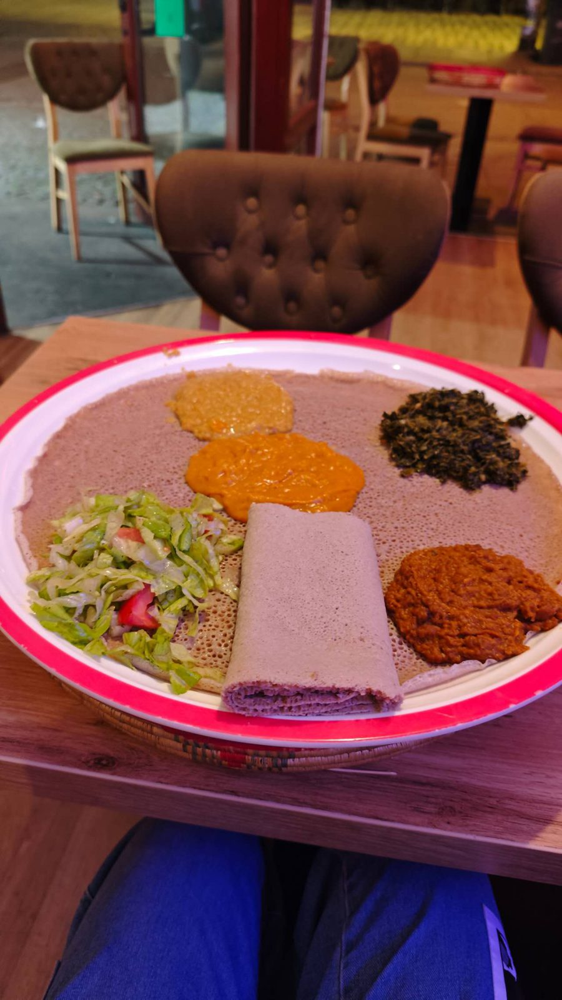{: .float-left style="width:25%"}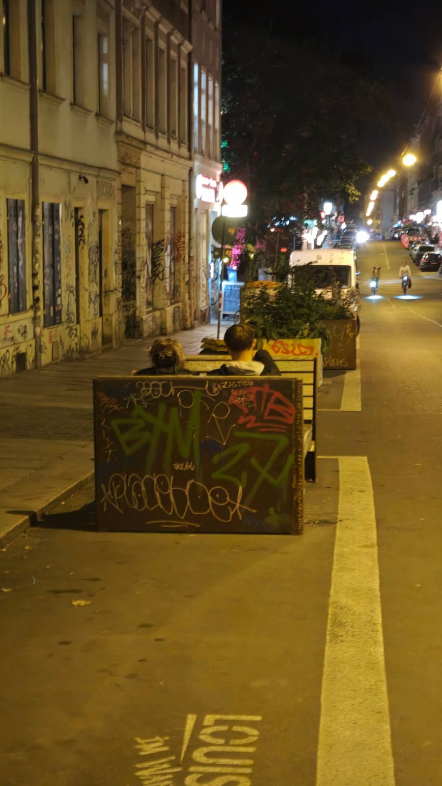{: .float-left style="width:25%"}

In the last stage of the Second World War, Dresden was reduced to ruins by the carpet bombing directed by Arthur Harris of the Royal Air Force. The reconstruction made extensive use of the original stone fragments, so today large black patches can be seen on the surfaces of rebuilt buildings such as the Court Church. Perhaps on that night in 1945 this stretch of water was also lit crimson by burning buildings. Now it simply reflects the blue sky, and when a yellow tram crosses the bridge, an illusory yellow shadow shimmers in the ripples. Cyclists and runners pass along the riverside paths and mudflats. This layered display of historical narrative and present-day life gave me a sense of harmony. At one point I jotted down this sentence: <u>Travelling in Europe, you see the Charleses, Fredericks and Augustuses; you see the Johns, Marias and St Francises; and you see the Müllers, Smiths and Andersens. They stand for royal power, for popes and patriarchs, and for ordinary townsfolk.</u>

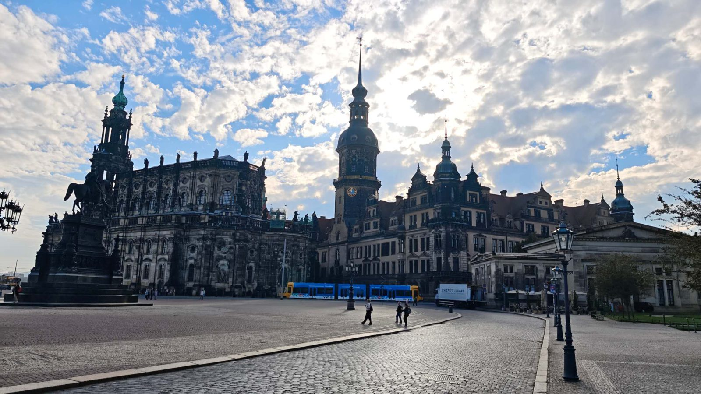{: style="width:50%"}
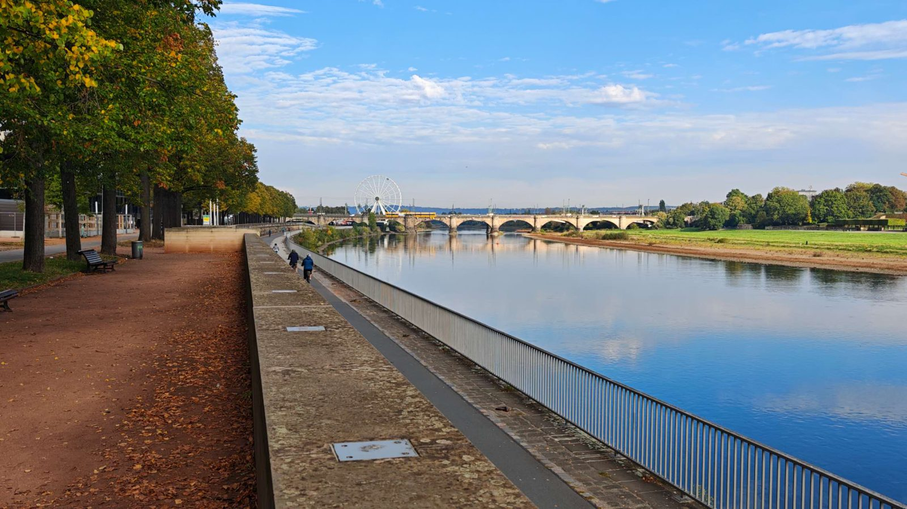{: style="width:50%"}

My next stop was Flensburg. The train ran north from Dresden through the German heartland, and when it reached Hamburg a delay meant I missed the connection, so I stopped over in Hamburg. Hamburg is Germany's second-largest city, where the Elbe opens toward the North Sea. With nearly two million people, lively shopping streets, high-rises and broad roads with endless traffic, it has the feel of a modern metropolis. From Hamburg station, the art museum, the opera house, the Elbphilharmonie and the Speicherstadt warehouse district form a loop. On the iron bridges of the Speicherstadt hang rows of blue, green, orange and red padlocks — people in East and West expressing their wish for "forever" in the same way. In front of Hamburg's harbour runs a waterfront promenade. The sunset, the ferries and the tourists taking photos on the promenade reminded me of the Bund in Shanghai, where tourists likewise take photos by the railings. The world is big, yet similar feelings often transcend distance, which makes me wonder whether limited experience can still build a rough picture of the world. Walking Hamburg's promenade felt for a moment like strolling along the Huangpu; I had had the same feeling on the Rhine promenade in Basel. Europeans eat cinnamon rolls, Chinese eat steamed flower rolls; lagom, a philosophy popular in Sweden — not too much, not too little, just right — was also expressed in the writings of Zhuangzi in the Warring States period. Having been to a few places, if I try to generalise: is there really a set of "basis vectors", as in linear algebra, with which to understand the whole world? The ancients' answer thousands of years ago was the butterfly and Zhuang Zhou — all things transform into one. For me, building such a perspective turns into a capacity to keep appreciating; a reminder to stay humble before a world without borders; a sense of luck at getting to see so much, and the settled confidence of "I have seen it".

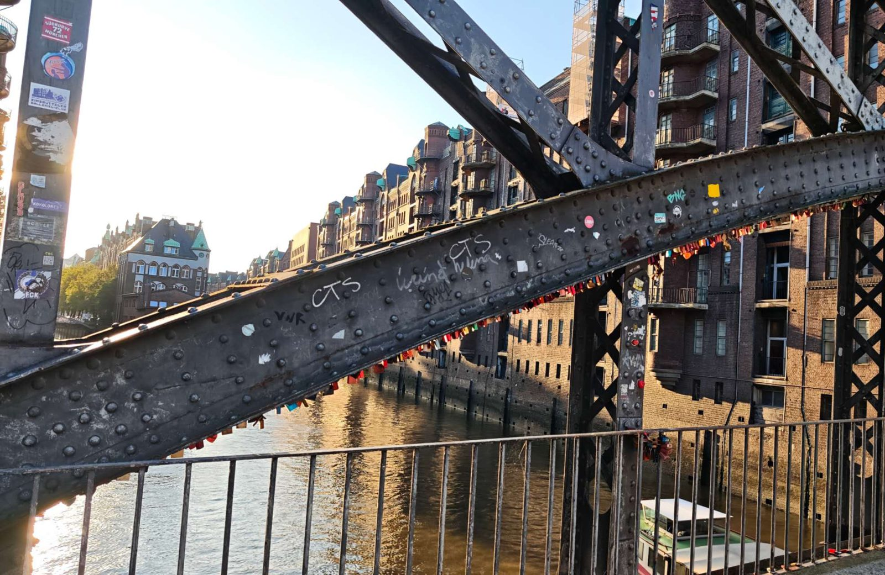{: style="width:50%"}
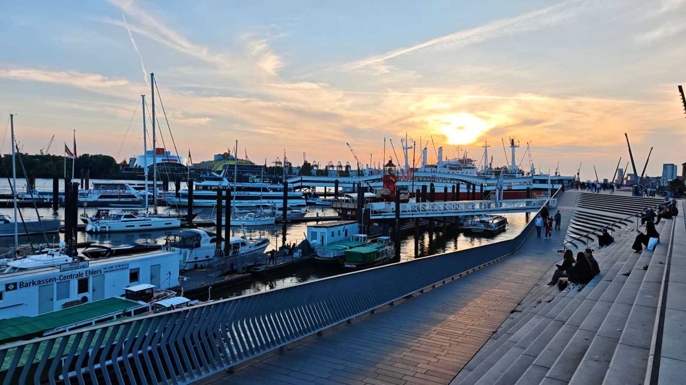{: style="width:50%"}

Flensburg is about two hours from Hamburg. Flensburg, at 54° north — the first time I had been further north than the northernmost point of China. The third-largest city in Schleswig-Holstein, it once belonged to the Kingdom of Denmark, until Denmark lost the war with Prussia and it became part of Germany. Like Hamburg, it rose on trade: Hamburg faces west, toward the North Sea, while Flensburg faces east, connected to the Baltic through the Flensburg Fjord. Here I made my first friend of the trip. On the bus from the station into town, I met a Chinese woman a little older than me. She took a liking to me, simply called me "little brother", and looked out for me warmly — sure enough, even by a northern harbour you can find kindred spirits of the jianghu. Flensburg's houses are distinctive: along the pedestrian street there are many openings, each leading into a small lane enclosed by buildings on three sides. This layout is called a merchant's courtyard: the shop on the street handled business, while goods shipped in from the harbour could be carried through the back to the warehouse. Cane sugar and raw spirit from the Caribbean were processed and blended here, distilled into rum. At around 40 per cent alcohol, a small sip gives first a mellow sweetness, then from the throat down the gullet to the stomach, a channel lit up hot and fiery. In this rainy northern land, the houses are mostly painted bright reds, yellows, blues and greens — both armour that protects the wood from rot and damp, and a dew that rinses off the dust and wakes the senses and the heart. I learned that she was here visiting a friend, an opera singer who rehearsed by day, so she roamed on her own. In the afternoon she planned to go to Sønderborg, and I happily went along.

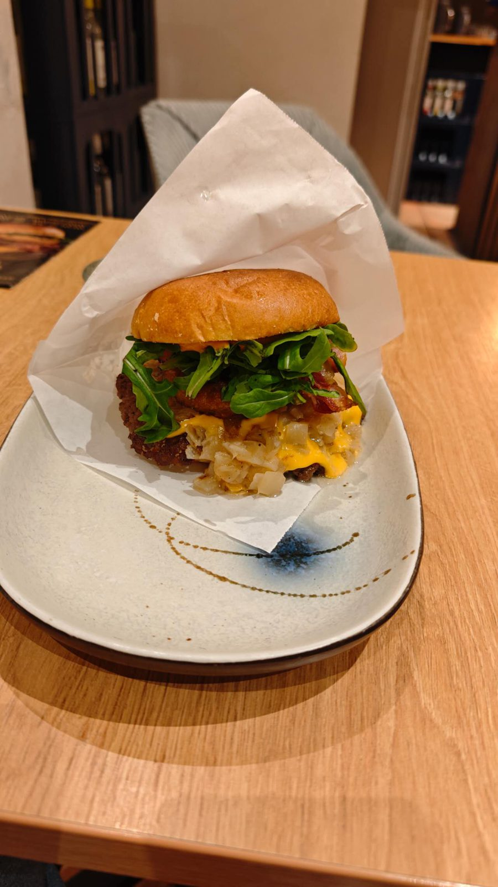{: style="width:25%"}
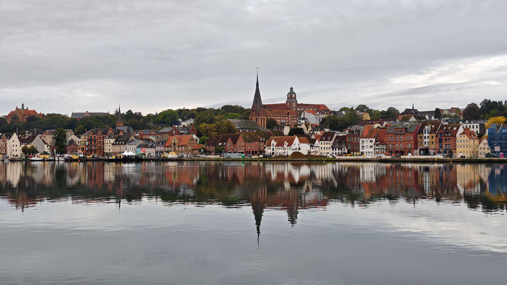{: style="width:50%"}
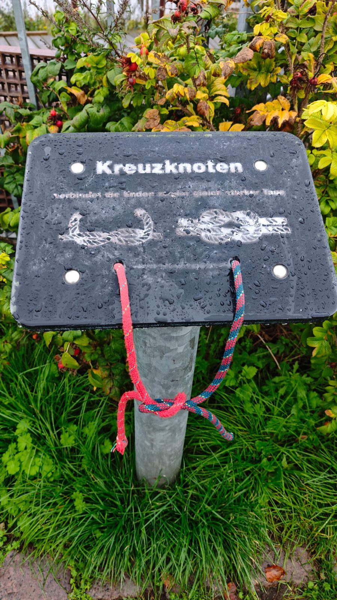{: style="width:25%"}

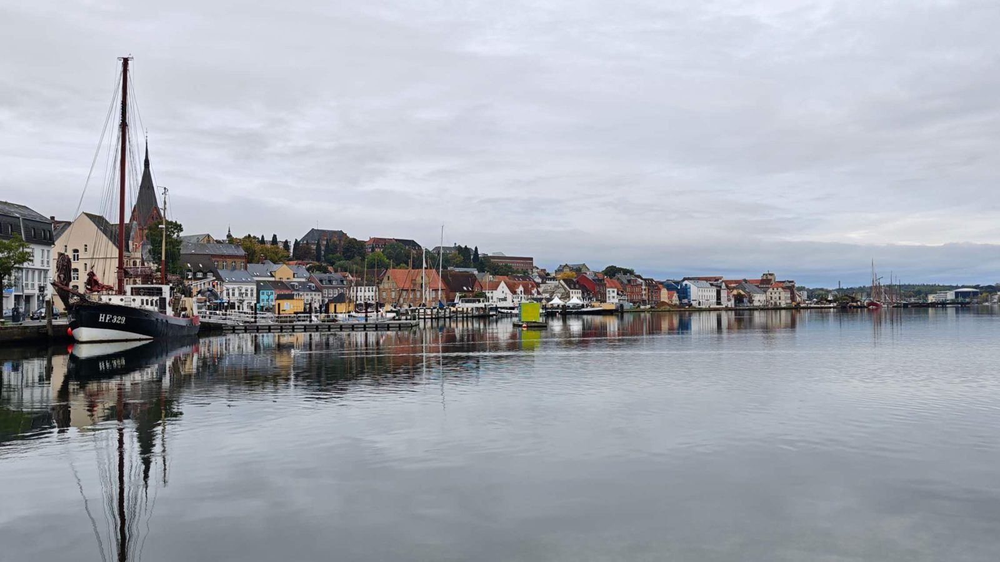{: style="width:50%"}
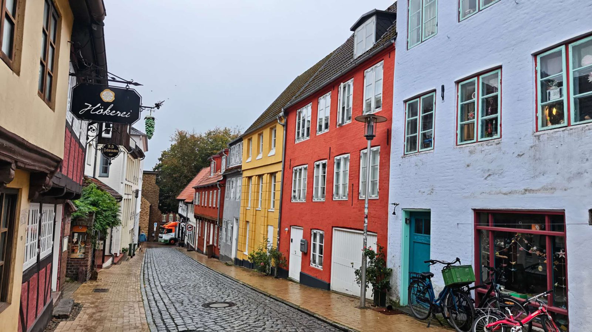{: style="width:50%"}

Sønderborg is a town on Als Fjord in southern Denmark. The sea wind blew hard, and the waves carried a few pale-red jellyfish to the shore. At the boundary between town and sea stands a castle, ochre walls and an orange-red roof, on a jutting piece of land. The ceaseless wind fluffed the clouds apart, blue showed through the leaden sky, the shadows of trees spread across the lawn, and the green turned vivid and warm. After a few turns between cloud and sun, more blue sky appeared and the whole sea became a clear, glittering blue. On the outer side of the promenade, sea and sky without end; on the inner side, a few trees with red berries — rowans, by their proper name — and a few huts selling ice cream. My friend informed me that eating ice cream in a down jacket is a Western cultural tradition.

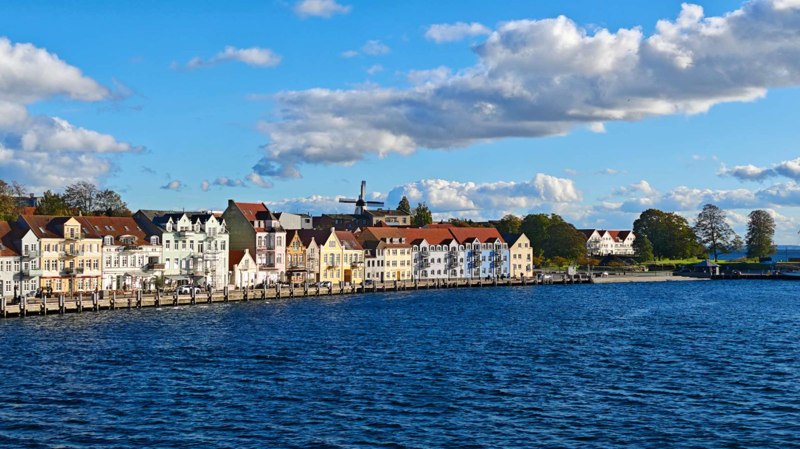{: style="width:50%"}
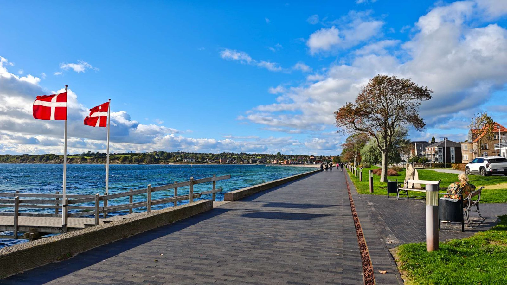{: style="width:50%"}

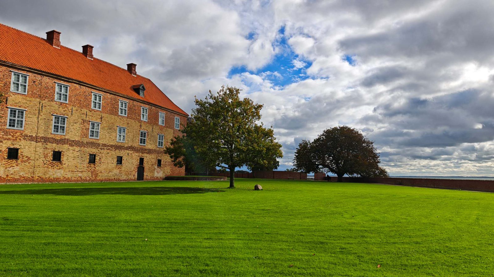{: style="width:50%"}

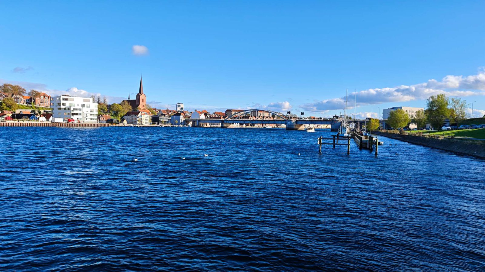{: style="width:50%"}

After we said goodbye, I set off for Copenhagen. Denmark is divided into five regions, with several large islands linked by sea bridges. Furthest west is the Jutland peninsula, in the middle is the island of Funen in the Region of Southern Denmark, and furthest east is Zealand, where the capital lies. In the day or two I spent here, I tried to feel Copenhagen's defining qualities: design, nature and happiness. Many examples suggest that certain qualities are born of polar environments; polarity creates contrast, like the raised and sunken characters of a carved seal or a handprint on a sand dune, making some things stand out more than others. On the <u>rainy, grey</u> eastern shore of the Atlantic grew the <u>brightly coloured</u> Scandinavian aesthetic; in the <u>ice and snow</u> at 55° north developed the Danish philosophy of a <u>warm and cosy</u> life, which they call hygge — the fireplace, woollen socks, mulled wine and coffee. In Copenhagen, my sense of design began with a stylish, highly rated hostel. Stone beams and plants decorated the outside; inside were vintage motorbikes, and the recycling bins were made to look like mailboxes. Here the hostel's social purpose, "connection", was stretched to the full. Chatting over a drink at the restaurant and bar, a round of table curling in the games area, or hearing 1980s ballads (e.g. The Winner Takes It All) from the karaoke sofas, then watching young people from all over the world shouting "low, low, low, low, low" together (Flo Rida, Low), before returning to a capsule pod for a sound night's sleep. After a buffet breakfast of yoghurt, cereal and ham toast, I found the natural and happy side of Copenhagen in the star-shaped fortress park in the north-east of the city. The fortress, standing on high ground in the water, is ringed by a moat; on the paths, parents ran with their children, and on the other side of the park the Little Mermaid statue gazes out toward the open sea. In Andersen's imagination, the mermaid turned to sea foam, the ugly duckling became a swan, and the matches on New Year's Eve illuminated a spiritual core reaching far beyond Denmark's forty thousand square kilometres. Walking past colourful Nyhavn and the brick-red, old-fashioned University of Copenhagen, I picked up a Hakkebøf (meat patty with potatoes), an everyday Danish dish, crossed the Øresund, and headed north along Sweden's west coast to Gothenburg.

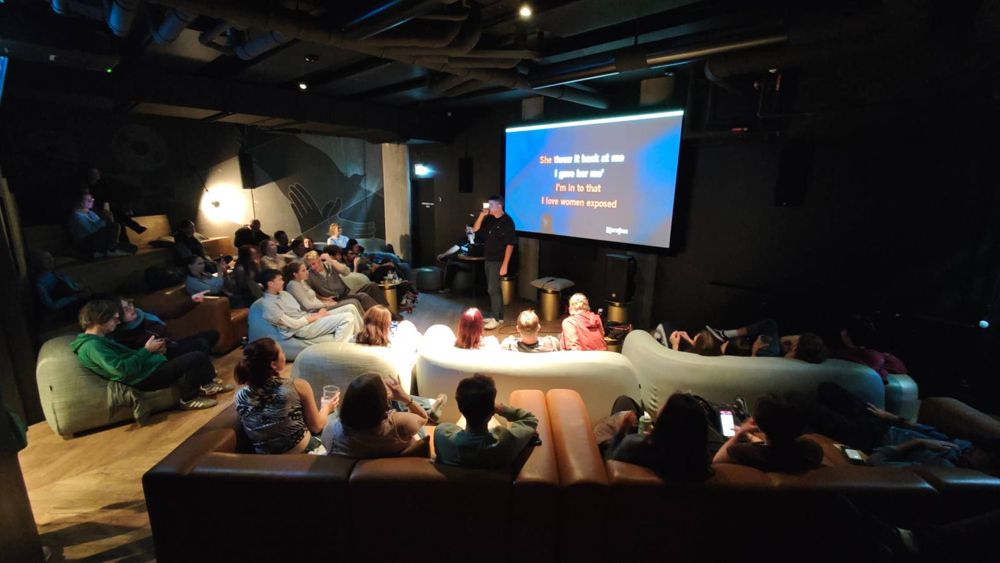{: style="width:25%"}
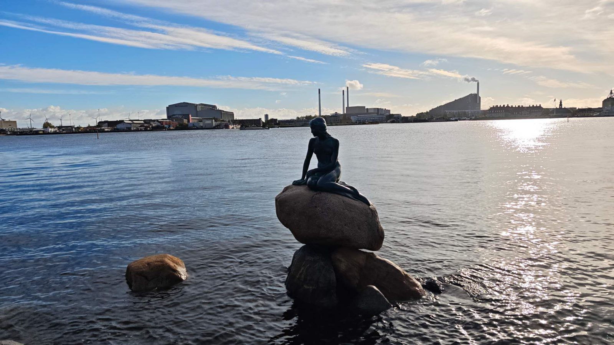{: style="width:25%"}

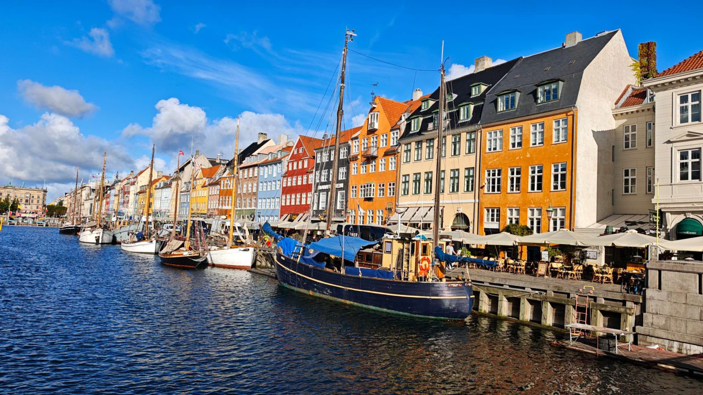{: .float-left style="width:50%"}

Gothenburg (Göteborg) is Sweden's second-largest city, though its actual pronunciation is closer to "Yoteborg", and it has nothing to do with Bach's "Goldberg Variations" — that work was written for Bach's student Goldberg; it is only in Chinese that both names come out the same. The city is known for its fika culture. Early on Saturday morning I wandered through the Old Town; the dampness left by the previous night's rain made it feel hushed. There were plenty of cafés on the grid of straight streets, but what was working the early shift was mostly the opening-hours sign taped inside the window. Missing out on the "palm-sized cinnamon bun" was, I suppose, a genuine experience of the Swedish idea of life "outside work". Curious, I looked up some of the "costs of being relaxed" — long waits in the healthcare system for non-urgent conditions, for instance, or public services slowed by very long holidays. Under this system people get more time of their own, but are also forced to learn to plan ahead and look after themselves. Efficiency and precision, ease and freedom — different systems settle into different equilibria. The night before, I had chatted with a fellow guest. He said ruefully that in Sweden people everywhere are moving to the big cities, to Stockholm; the Gothenburg government says it wants to attract two hundred thousand workers, but housing has not kept up, and he had already been living in the hostel for several days. He was a viola player, waiting here for a chance to stand in with an orchestra. "The viola has such a beautiful sound," I said. He smiled: "People always say that."

I went on to Stockholm. The Swedish capital lies on the east coast. Between Sweden's east and west coasts stretches a vast landscape of lakes and forests. It is said that long ago the land bore a thick ice sheet; when the ice melted, the compressed crust rebounded, cutting off fjords that had once opened to the sea, while the basins gouged out by the glaciers caught the plentiful rain, forming lake after lake. As the train moved at speed, the rain on the window drew out into streamlines; when the train slowed, the streamlines lost their support and slid forward. When I reached Stockholm it was still raining, so I took shelter in a museum. The Nationalmuseum was showing an exhibition on the seaside as seen by painters; one of the works was Monet's The Path to the Sea (Le Chemin de la Cavée, Pourville). Standing before the golden frame, I tried to describe a painting: here is a clump of grass, it is yellow — and suddenly I thought of the feeling of chewing sugarcane. I tried to imagine how artists, surveying a 360-degree panorama, find inspiration and resonance in that one degree, and what the other 359 degrees look like. At five in the afternoon I came out of the museum; the Royal Palace and a row of solid, elegant buildings faced me across the water. The strong wind by the river made people walk faster, as if that force could also push the hands of some great clock and set time forward; the sky to the north was about to darken. Central Stockholm is often described as twelve floating, connected islands. According to the guidebooks, the northern island is for commuters and office workers, with the central station and the university; in the middle is the Old Town (Gamla Stan); and the southern island (Södermalm) feels more lived-in. So I went to Södermalm to look for some Swedish flavour. There, shops and restaurants line a north–south main street. Dissecting a city's districts starting from its transit lines is something I have learned from exploring cities: tapping the central station on a map to show the metro network often lays bare the city's flows. As in Denmark, the common food staples here are potatoes and meatballs; back in Zurich, whenever my flatmate and I went to IKEA, he would order the Swedish meatballs. The next day, after ticking off a few of Stockholm's iconic colourful metro stations, I would head to the other side of the Baltic.

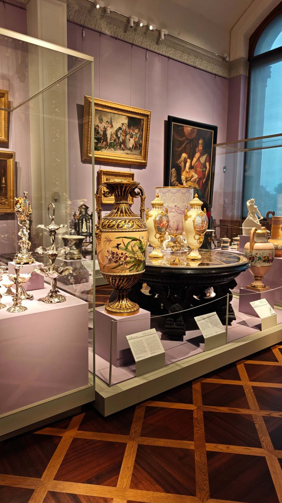{: style="width:25%"}
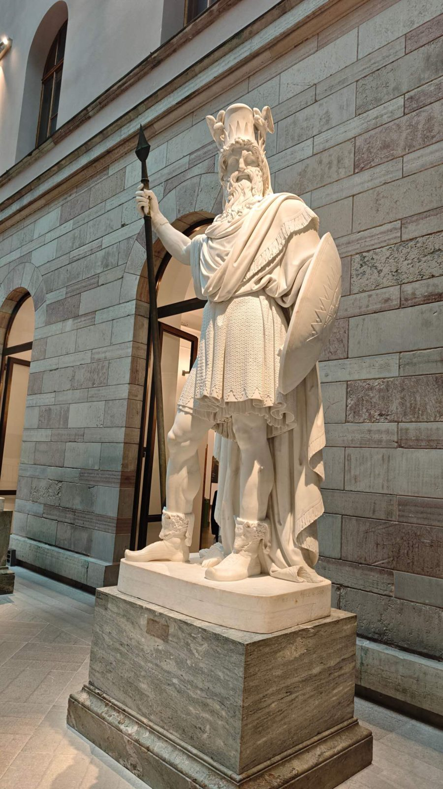{: style="width:25%"}
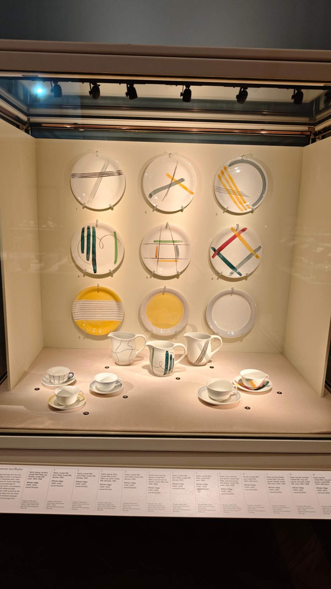{: style="width:25%"}
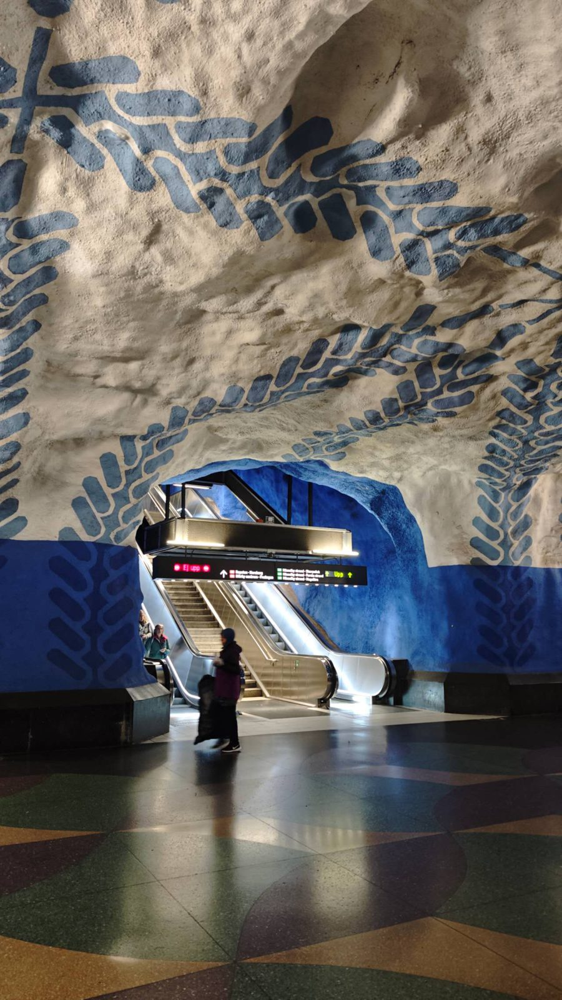{: style="width:25%"}

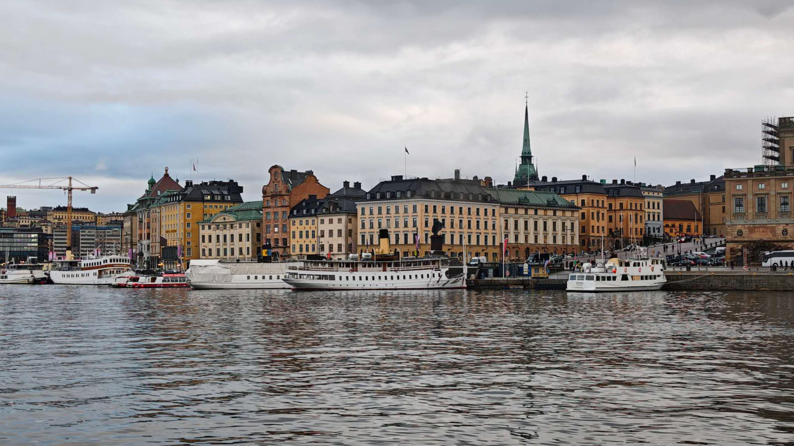{: style="width:50%"}

After a flight of about an hour I was in Riga, the capital of Latvia. Like Dresden, Riga has a river through its centre dividing the two banks. The west bank, where the airport is, has modern buildings; a 40-minute bus ride east across the Daugava brings you to the historic Old Town on the east bank. The Old Town is cut into tofu-like blocks by a grid of pedestrian streets; along one side runs a park in the heart of the city, shady with trees, with a city canal fed from the sea winding through it, and the University of Latvia and the National Opera on either side. Parks in the East often have pavilions, terraces, covered walkways and rockeries, while those in the West use more natural elements — stout trees, streams and lawns. On a drizzly evening I explored this new city under an umbrella. On one corner was a heavy wooden door hung with vines, flanked by shields and banners; up close, the shields read "Medieval Restaurant". I went in. Dim lights shone on the bottles and jars in the wooden cupboards, and a spiral staircase led down to the entrance of a vault. Hanging lamps under the arches and candles on the tables divided the vault into small pockets of light; the waiters wore medieval-style white caps and wide-sleeved robes under green tabards. Not far away was a black-magic bar in a similar style, with an alchemist's red and brown conical flasks and round-bottomed flasks on the shelves and thick books lying toppled or stacked. A glass of Black Magic balsam and a truffle chocolate: in the thin smoke rising from the flame of a slender candle, it felt like rewinding to royal intrigues glinting with cold steel, and the elegant, mellow British accents around me might be deciding the rise and fall of families thousands of kilometres away. The next morning I walked past the Art Nouveau façades of Alberta iela — the many human faces and curling ornaments on the walls are typical of the style. The Riga campus of the Stockholm School of Economics is also here, founded for the historic task of moving to a market economy after the collapse of the Soviet Union. Then, at Riga Central Market, people trade the gifts of the sea. Most common is herring, with a hint of smoke. There is also salted dried fish — it reminded me that when I was little, my family called socks hung out to dry "dried fish", which really is apt. I opened an AI app for a crash course in seafood: the yellow ones are mackerel, the deep red is trout roe, the flat ones are squid strips, and there were rich orange salmon rolls. I also learned a little about the Baltic: because it exchanges water with the Atlantic only through Denmark's narrow straits, its water renews slowly, and with large inflows of fresh water from the surrounding rivers and low evaporation, the Baltic has become the least salty sea in the world. There are indeed some concerns about pollution, but for a tourist having a taste, there is nothing to worry about. I bought a salmon roll and a beef pancake; next stop, Tallinn.

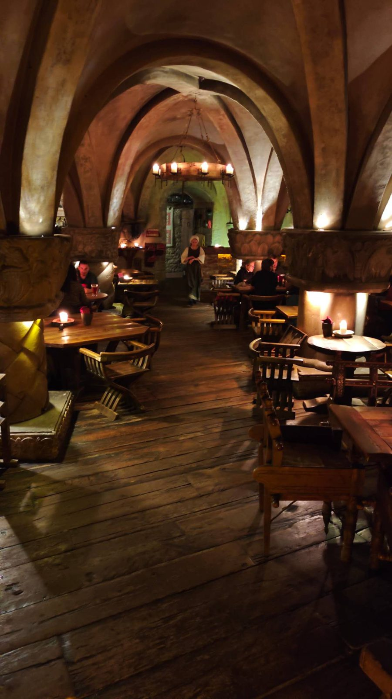{: style="width:25%"}
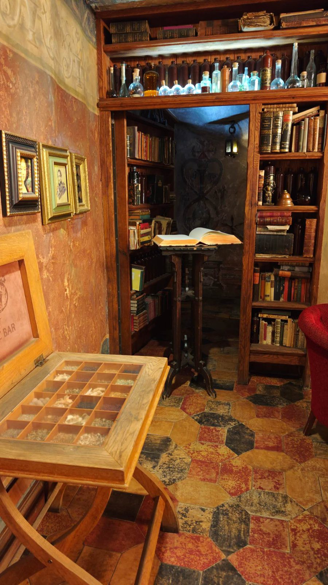{: style="width:25%"}
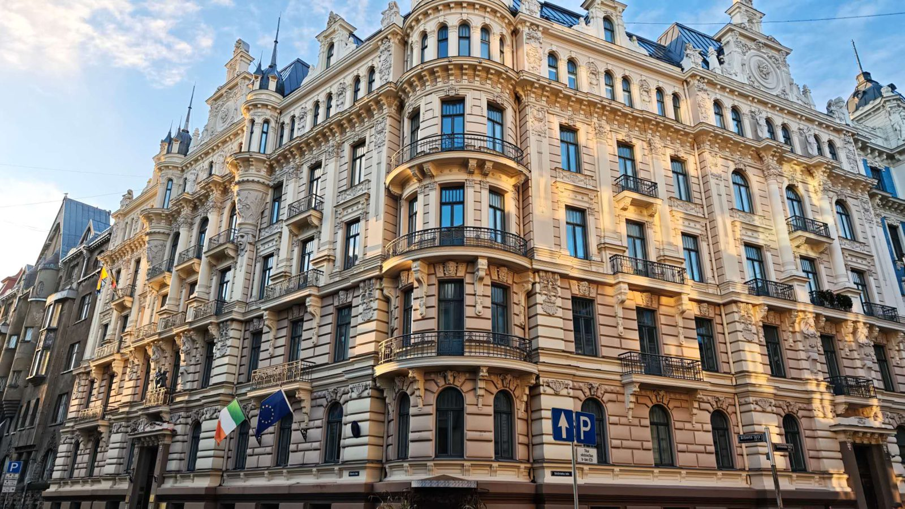{: style="width:50%"}

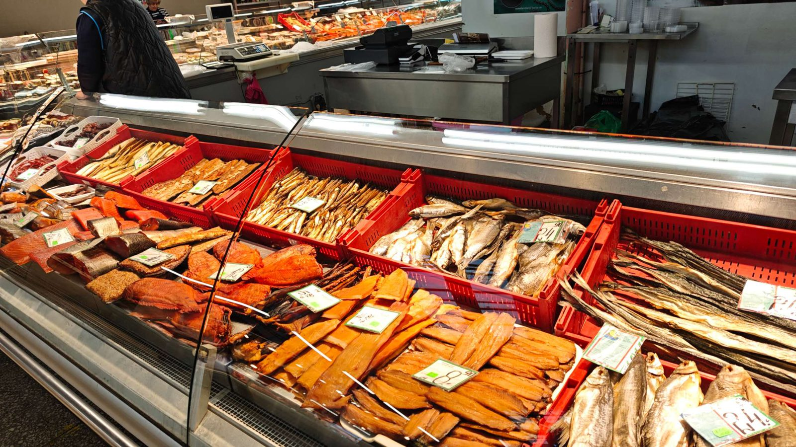{: style="width:50%"}

From Riga to Tallinn is a six-hour bus ride, with only a few departures a day; I set off at noon. The weather was fine, and under the blue sky the yellow leaves were still brilliant. From Tallinn bus station I crossed a large park and reached the Old Town, where stone houses, stone walls and cobbled streets set out its medieval character. The next day I bought some milk-caramel toffee at the supermarket as souvenirs — said to be a classic Soviet taste. On Toompea hill on the west side of the Old Town stand a Lutheran cathedral of St Mary and an onion-domed Orthodox cathedral. The early Danes brought Roman Catholicism; later the region came under Swedish rule and turned Protestant; later still, Estonia was ruled by the Russian tsars, and Orthodoxy was vigorously promoted.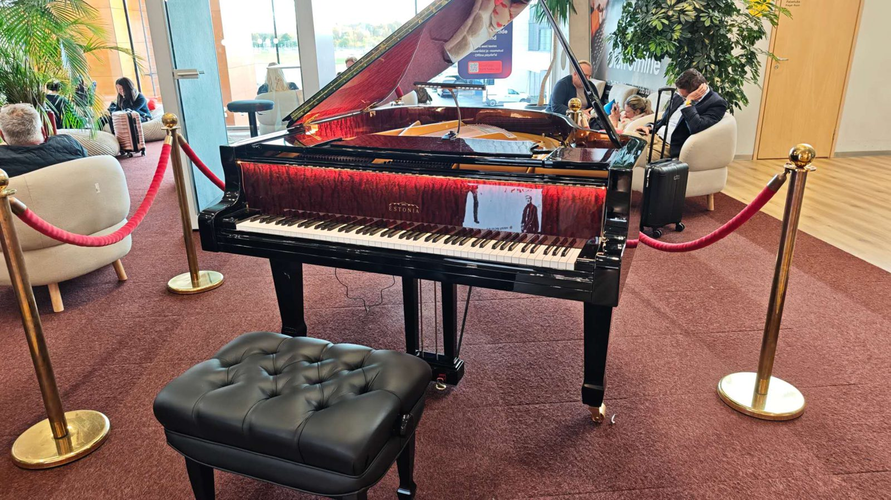{: .float-right style="width:25%"} At noon I found a crêpe place in the Old Town. While I waited for a table, two women came to share mine, one from France and one from Germany. Anne, the Frenchwoman, chatted with me and asked about my travel plans, politely adding, "if you'd like to talk about it". Later I learned they were a study group from the legal prosecution system, having a working lunch here. I joked that I should have guessed their profession at once from "the right to remain silent". She laughed heartily, and when we parted she gave me a box of French sea-salt caramels from the Vendée in Brittany. After leaving the restaurant I noticed a message about a flight change: I had planned to fly from Tallinn to Vienna, but a delay on the first leg meant I would miss the connection, and so Kraków was added to the itinerary. The open piano at Tallinn airport made the wait less dull — I learned a passage of Debussy's Arabesque — and after nightfall I landed in Kraków, where I would spend the night.

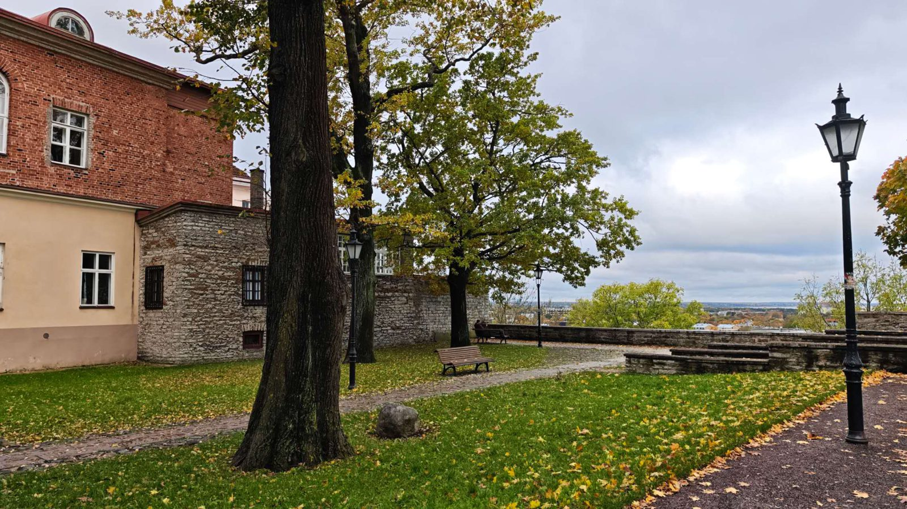{: style="width:50%"}
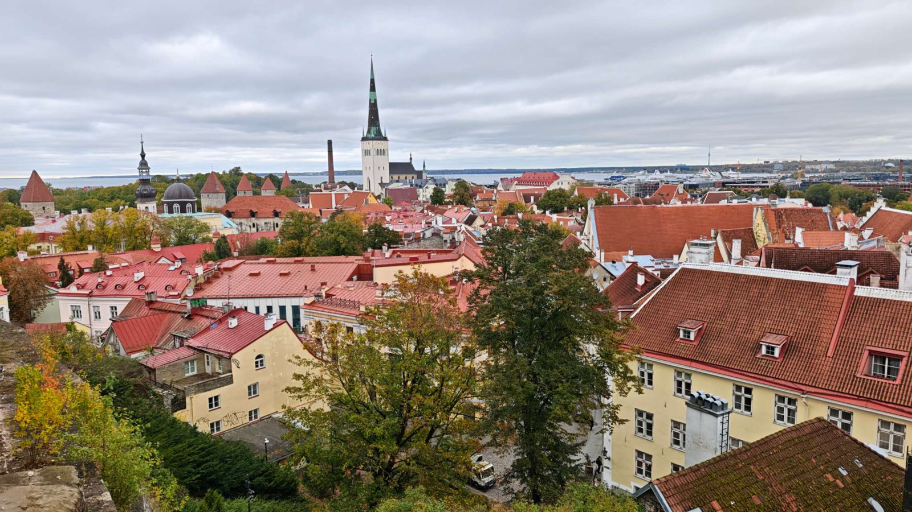{: style="width:50%"}

Kraków is a major city in southern Poland and was once the Polish capital. On this trip I had many good supermarket experiences: the cinnamon-bun bread from a Stockholm supermarket, and the milk toffee and baked pizza from a Tallinn supermarket, all left an impression on me and changed some of my ideas about standardised products, so here too I bought a box of Polish pierogi at the supermarket. At the centre of the Old Town is the Main Market Square, Rynek Główny, surrounded by square, elegant buildings. Around the Old Town is a ring of parkland, with broad, straight paths shaded by trees on both sides; further out, the Vistula flows through the city. In the early morning the blue sky was mirrored on the river like a sky mirror. After wandering around the city for a while, I took the bus to the last stop of the trip, Vienna, the city of music.

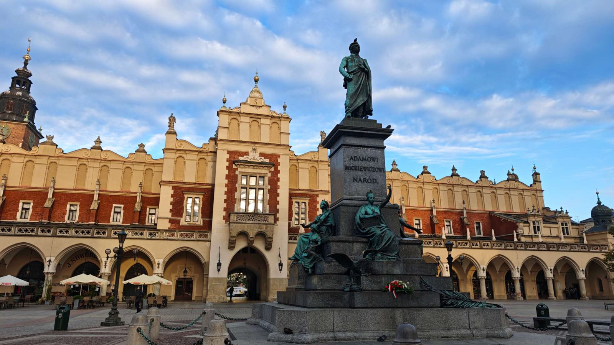{: style="width:50%"}
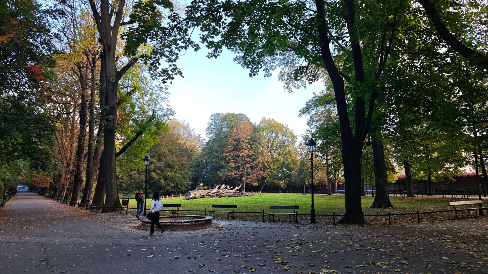{: style="width:50%"}

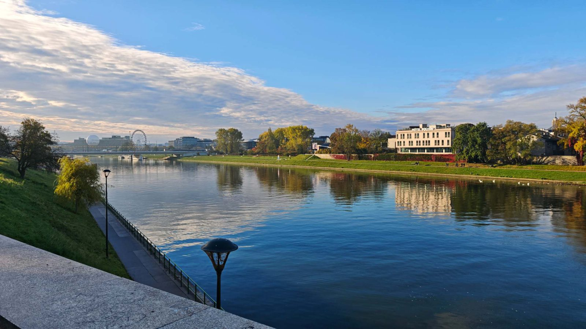{: style="width:50%"}

When I arrived, my first impression was that this is a city for living: taking the metro at 5 p.m., I found myself in a long-forgotten after-work rush hour. Vienna has two million people — four times as many as Zurich, three times as many as Copenhagen. A friend doing a PhD here showed me around the university campus, and then we strolled along the broad avenues of the Prater, catching up; my friend treated me to grilled fish for dinner, and I gave the postcards I had brought from Copenhagen as a present — an "academic exchange", we called it. In Vienna, classic operas such as Carmen and The Barber of Seville are performed every day. Early the next morning I went to Karlsplatz in the city centre, but the Golden Hall, being the musicians' workplace, is open to the public only for afternoon tours and evening performances, and the Karlskirche next door was under renovation. I stood on the street, cars coming and going, and suddenly a strange force rose in me: why not just go back now. The churches, the roses in the Belvedere gardens, and many more dazzling, splendid buildings — they will always be there. Having a coffee in a Viennese café no longer seemed necessary either. What should one see when travelling? What should one hope for from travel? I remembered the hostel in Stockholm, listening to people talk; from a string of "but"s and a slightly aggrieved tone, I gathered that perhaps half of all travellers are not necessarily full of hope and longing — people end up in all sorts of places for all sorts of reasons. When I feel I have been away long enough, then it is time to go home. The tram ran toward the station, where I bought a Wiener schnitzel and a roast pork knuckle at the supermarket. The train headed west, past Salzburg, past Innsbruck; in the beautiful Inn valley there were many evergreens that do not turn yellow even in autumn. On the mountain road back to Ägeri, a brilliant sunset reddened the sky, higher up was a deep blue, and under the bright moon the shores of Lake Zug glittered with lights.

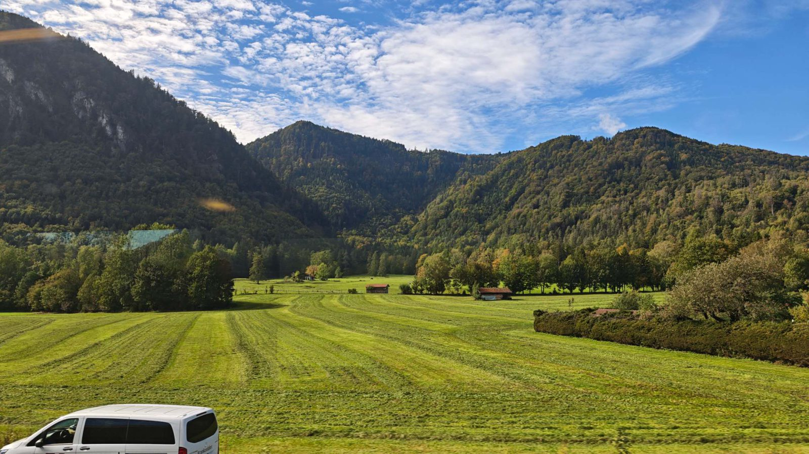{: style="width:50%"}
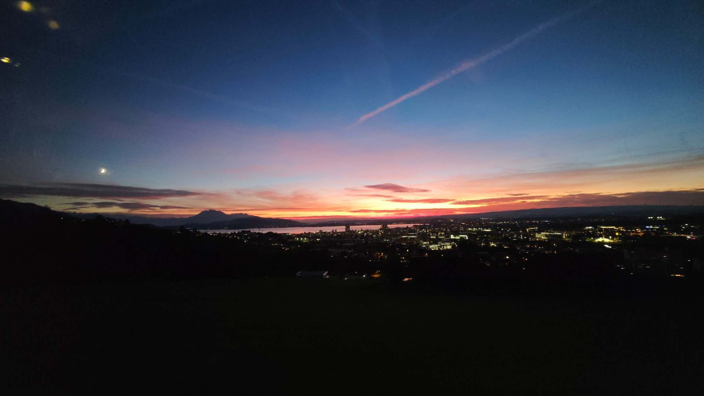{: style="width:50%"}

\[End of Part I\]

II Liguria, Tuscany — Italy

A few weeks later, I came to Italy.

III Athens, Greece

\[The Story of the Prince-Electors\]

\[The Story of the Wittelsbachs (Bavaria and the Palatinate)\]

\[Munich's Mad King and Neuschwanstein Castle\]

\[The Story of Henry the Lion: Munich and Lübeck, Twin Cities of South and North\]

\[The Glockenspiel of Munich's Town Hall\]

Medieval knights' wedding, the coopers' dance, the plague

\[City History · Munich\]

\[The Story of Saxony\]

\[The Story of European Names\]

\[Nordic House Colours, and the Story of Stone\]

\[The Story of the Hanseatic Merchants\]

\[The Kingdom of Denmark, and the Danish–Prussian War\]

\[The Six Base Spirits\]

\[Danish and Swedish\]

\[Plants: the Rowan\]

\[Nordic Food\]

\[History of Riga\]

- In the 16th and 17th centuries, ruled in turn by the Polish–Lithuanian Commonwealth and the Swedish Empire.
- After the Great Northern War in the 18th century, Riga was annexed by the **Russian Empire** in 1721 and quickly grew into the tsarist empire's main naval port and commercial hub on the north-western Baltic coast

\[History of Poland\]

Art

Extras
