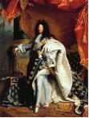
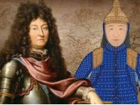

\[The Story of Saxony\]

[**The history of Saxony (Sachsen)**](https://www.google.com/search?kgmid=%2Fm%2F070zc) is a thousand-year story of geographical and political drift. \[[1](https://baike.baidu.com/item/%E8%90%A8%E5%85%8B%E6%A3%AE%E5%85%AC%E5%9B%BD/6185598)\]

In German history, **the name "Saxony" underwent a dramatic geographical migration**: the original "Old Saxony" referred to north-western Germany near the North Sea (today's Lower Saxony), while the Saxony people know today (centred on Dresden and Leipzig) is the **Electorate and Kingdom of Saxony** of Central European history, in the Elbe basin of eastern Germany. \[[1](https://visitsaxony.cn/saxony-in-a-nutshell.html), [2](https://baike.baidu.com/item/%E8%90%A8%E5%85%8B%E6%A3%AE%E5%85%AC%E5%9B%BD/6185598), [3](https://baike.baidu.com/item/%E8%90%A8%E5%85%8B%E6%A3%AE%E7%8E%8B%E5%9B%BD/1761559)\]

Saxony's history falls clearly into a few key periods:

**1. The tribal period and Christianisation (3rd–9th centuries)**

- **Tenacious Germanic tribes**: The first Saxons were a number of independent Germanic tribes living along the North Sea coast (today's north-western Germany). Some of them, in search of new land, crossed the North Sea to Great Britain in the 5th century, merged with the Angles and became the "Anglo-Saxons" of English history. \[[1](https://zh.wikipedia.org/zh-cn/%E8%90%A8%E5%85%8B%E6%A3%AE%E5%8E%86%E5%8F%B2), [2](https://baike.baidu.com/item/%E8%90%A8%E5%85%8B%E6%A3%AE%E5%85%AC%E5%9B%BD/6185598), [3](https://baike.baidu.com/item/%E7%9B%8E%E6%A0%BC%E9%B2%81-%E6%92%92%E5%85%8B%E9%80%8A%E4%BA%BA/8591707)\]
- **Thirty years of Saxon Wars**: The Saxons who stayed on the continent were extremely stubborn. Charlemagne of the Frankish kingdom spent more than thirty years (772–804) waging the "Saxon Wars" before finally conquering the land, forcing the Saxons to convert to Christianity and formally incorporating it into the Carolingian Empire. \[[1](https://zh.wikipedia.org/zh-tw/%E8%90%A8%E5%85%8B%E6%A3%AE%E5%85%AC%E5%9B%BD), [2](https://baike.baidu.com/item/%E8%90%A8%E5%85%8B%E6%A3%AE%E5%85%AC%E5%9B%BD/6185598)\]

**2. The stem duchy and the Ottonian Empire (9th–12th centuries)**

- **The heart of the empire**: After the Treaty of Verdun in 843 split the empire, the Duchy of Saxony became one of the five great stem duchies of East Francia (later the Kingdom of Germany).
- **The glory of the Saxon dynasty**: In 919, the Saxon duke Henry I, "the Fowler", was elected King of Germany, founding the **Saxon (Ottonian) dynasty**. His son **Otto the Great** (Otto I) was crowned Holy Roman Emperor in 962, and Saxony thus became the birthplace of the Holy Roman Empire. \[[1](https://zh.wikipedia.org/zh-cn/%E8%90%A8%E5%85%8B%E6%A3%AE%E5%8E%86%E5%8F%B2), [2](https://baike.baidu.com/item/%E8%90%A8%E5%85%8B%E6%A3%AE%E5%85%AC%E5%9B%BD/6185598), [3](https://zh.wikipedia.org/zh-tw/%E8%90%A8%E5%85%8B%E6%A3%AE%E5%85%AC%E5%9B%BD)\]

**3. Wettin rule and the geographical drift (12th–18th centuries)**

- **The fall of Henry the Lion**: In 1180, the over-mighty Saxon duke Henry the Lion was deposed by the emperor; the powerful stem duchy of Saxony was dismembered and its core territory in north-western Germany stripped away. \[[1](https://zh.wikipedia.org/zh-cn/%E8%90%A8%E5%85%8B%E6%A3%AE%E5%85%AC%E5%9B%BD)\]
- **The move east and electoral status**: Through a series of enfeoffments and territorial changes, the name "Saxony" travelled with the ruling title south-eastwards to the upper Elbe. In 1423 the **House of Wettin** took over the land and gained the title of Prince-Elector (the right to elect the Holy Roman Emperor), beginning more than 800 years of Wettin rule over Saxony. \[[1](https://visitsaxony.cn/saxony-in-a-nutshell.html), [2](https://baike.baidu.com/item/%E8%90%A8%E5%85%8B%E6%A3%AE%E5%85%AC%E5%9B%BD/6185598)\]
- **The golden age of the Baroque**: From the late 17th to the early 18th century, Saxony had its most dazzling ruler — **Augustus the Strong**. Also King of Poland, he built lavishly in his capital **Dresden** (the Zwinger, the Frauenkirche), turning it into a famous European stronghold of Baroque art and culture, known as the "Florence on the Elbe". In this period Saxony also cracked the secret of Chinese porcelain and founded Europe's first hard-paste porcelain factory — the famous [Meissen porcelain](https://visitsaxony.cn/saxony-in-a-nutshell.html). \[[1](https://www.alange-soehne.com/hk-sc/manufacture/heritage/saxony-under-augustus-the-strong), [2](https://visitsaxony.cn/saxony-in-a-nutshell.html)\]

**4. War, kingdom and member of the Empire (19th–early 20th century)**

- **The Kingdom of Saxony**: In the Napoleonic Wars Saxony allied itself with Napoleon. After the Battle of Jena in 1806, with Napoleon's backing, the Electorate of Saxony was formally raised to the **Kingdom of Saxony**.
- **Prussia's punishment**: After Napoleon's defeat, at the Congress of Vienna in 1815, as punishment for "backing the wrong side", the Kingdom of Saxony was forced to cede **two-fifths of its territory** to Prussia. In 1871 it joined the German Empire unified under Prussian leadership as a constituent state. \[[1](https://baike.baidu.com/item/%E8%90%A8%E5%85%8B%E6%A3%AE%E7%8E%8B%E5%9B%BD/1761559), [2](https://www.wikiwand.com/zh-mo/%E8%96%A9%E5%85%8B%E6%A3%AE%E7%8E%8B%E5%9C%8B)\]

**5. Modern Saxony (1918 to today)**

- With the end of the First World War in 1918, the German monarchy collapsed, the last king abdicated, and Saxony became the [**Free State of Saxony**](https://www.google.com/search?kgmid=%2Fm%2F070zc) within the Weimar Republic.
- At the end of the Second World War, the capital Dresden suffered devastating Allied carpet bombing. After the war Saxony fell into the Soviet occupation zone and became the most industrialised region of **East Germany (the German Democratic Republic)**.
- **Reunification and technological rebirth**: After German reunification in 1990, the [<u>Free State of Saxony</u>](https://www.google.com/search?kgmid=%2Fm%2F070zc) was re-established. Building on its deep industrial roots and its microelectronics industry, modern Saxony (especially the Dresden area) has become one of Europe's most important centres for semiconductor and chip manufacturing, known as **"Silicon Saxony"**. \[[1](https://zh.wikipedia.org/wiki/%E8%90%A8%E5%85%8B%E9%81%9C), [2](https://baike.baidu.com/item/%E8%90%A8%E5%85%8B%E6%A3%AE%E7%8E%8B%E5%9B%BD/1761559)\]

Saxony's history is vast. If you'd like to go deeper into any part of it, let me know:

- How did **Otto the Great** of the Saxon dynasty unify Germany?
- The lavish stories of **Augustus the Strong** and the Baroque era?
- How did modern Dresden rise from the ruins to become **a European centre of technology and semiconductors**?

**Augustus the Strong was without doubt a fervent admirer and follower of the French king** [**Louis XIV**](https://www.google.com/search?kgmid=%2Fm%2F04pwg). Not only did he long to imitate Louis XIV's image as an absolute monarch in politics; in taste and city-building, too, he held Louis XIV up as a lifelong idol. \[[1](https://zh.wikipedia.org/zh-tw/%E5%A5%A5%E5%8F%A4%E6%96%AF%E7%89%B9%E4%BA%8C%E4%B8%96_(%E6%B3%A2%E5%85%B0)), [2](https://baike.baidu.com/item/%E5%A5%A5%E5%8F%A4%E6%96%AF%E7%89%B9%E4%BA%8C%E4%B8%96/3799082), [3](https://visitsaxony.cn/famous-brands/august-the-strong.html)\]

Augustus's admiration and imitation of Louis XIV showed mainly in the following ways:

- **A soul-stirring youthful journey**: As a young man (1687–1689), before he inherited the Saxon electorate, Augustus visited Louis XIV's Versailles while touring Europe. The unrivalled luxury and pomp of Versailles, its grand Baroque architecture and Louis XIV's supreme absolute power left an indelible impression on the young Saxon prince. \[[1](https://visitsaxony.cn/famous-brands/august-the-strong.html), [2](https://zh.wikipedia.org/zh-tw/%E5%A5%A5%E5%8F%A4%E6%96%AF%E7%89%B9%E4%BA%8C%E4%B8%96_(%E6%B3%A2%E5%85%B0))\]
- **Building a "Saxon Versailles"**: Back in Saxony as ruler, Augustus remodelled his capital Dresden almost entirely on the pattern of Versailles. He built the extravagant [Zwinger](https://visitsaxony.cn/famous-brands/august-the-strong.html), enlarged Dresden Castle, and created the Green Vault, the finest treasure chamber in Europe. He even planned a huge "Saxon Versailles" garden at Großsedlitz. \[[1](https://pinnable.eu/article/court-of-augustus-the-strong), [2](https://visitsaxony.cn/famous-brands/august-the-strong.html), [3](https://news.sina.cn/2017-11-20/detail-ifynwxum6507014.d.html?vt=4)\]
- **Royal image and the politics of mistresses**: Louis XIV called himself the "Sun King"; Augustus styled himself the "Saxon Hercules" and loved to show off his strength at court banquets by snapping horseshoes with his bare hands. Imitating the French court, he also kept a great many mistresses and held lavish Baroque festivities that could last for months. \[[1](https://www.alange-soehne.com/us-en/manufacture/heritage/saxony-under-augustus-the-strong), [2](https://baike.baidu.com/item/%E5%A5%A5%E5%8F%A4%E6%96%AF%E7%89%B9%E4%BA%8C%E4%B8%96/3799082), [3](https://artsandculture.google.com/entity/augustus-ii-the-strong/m01ktmq?hl=en)\]
- **The pursuit of absolute monarchy**: Politically, Augustus spent his whole life trying to curb the nobility and the estates at home, seeking to establish in Saxony a highly centralised "absolute monarchy" like France's. \[[1](https://baike.baidu.com/item/%E5%A5%A5%E5%8F%A4%E6%96%AF%E7%89%B9%E4%BA%8C%E4%B8%96/3799082), [2](https://zh.wikipedia.org/zh-tw/%E5%A5%A5%E5%8F%A4%E6%96%AF%E7%89%B9%E4%BA%8C%E4%B8%96_(%E6%B3%A2%E5%85%B0))\]

Voltaire once remarked that the Dresden court under Augustus was "second in luxury and splendour in all of Europe only to Louis XIV's Versailles".
