最初我想写的题目是 “城市性格”，以前我所记录的，大都是阿尔卑斯自然景色的篇章，这次，我想去感受城市。在临行之前的想象，我会坐在某个广场一角的咖啡馆，遮阳棚向外支出，广场中央有一块石碑，我看着人们沿着斜线走过。

旅行的规划和执行做得很成功。旅行结束，银行卡和护照还在，遇见一多半的好天气，我已应足够感激。但我觉得不够高兴，甚至有点疲乏，我似乎没有学会怎么去欣赏旅行中的遇见，我在10天没看电脑以后仍然觉得脖子不适，优越和受挫激发的攻击性仍像未精熟的六脉神剑不受控地发出，我一坐回我的座位仍然自动地翘起二郎腿，好像一切都没有改变。我大概也很难写出对"城市性格"的观察。

我想了一些其他的副标题，\
---"当我旅行时，我在想些什么"，\
---"作为旅行家的我"，\
---"我与AI的聊天记录"。

无论怎样，我总会写些什么，我享受这个过程，舒适的字号和间距，好像反刍的动物去吃米其林餐厅就可以算成半价打折一样，记忆之河从头缓缓流淌，碰到的元素被一盏盏点亮。我在准备和旅程的过程中问过AI很多不同的事，{巴伐利亚和萨克森，选帝侯}，{朗姆酒，Burek和鲱鱼}，{新艺术运动，瑞典国家博物馆的镇馆之宝}，{维也纳和塔林的人口数量，波罗的海鱼类污染}，{安徒生童话和卡门的观剧指南} …. 像拿起一串葡萄，旅行是茎，在这串茎上挂缀着果实。

那叫旅行哈希吧，Hash是我在丹麦学到的词，类似于大乱炖。或者叫做旅行斥候 Scout，粗略而迅捷的侦察，这是我的第一次欧洲旅行，大概感受一下世界广阔的初印象。

很早，5：20，我从埃格里出发，坐上前往楚格的601路。因为第一次去找flixbus的长途车站， 我决定早点走，从苏黎世去慕尼黑的大巴早上7点出发。在这么早的车上，已经七七八八坐上了人，其中一个拿着一个大的Lidl口袋，看起来像是去上班的人。在火车站的站台上，一个小女孩在她的行李箱旁手舞足蹈兴奋不已，我想，人们或许一年也不会旅行几次，那碰到恰好一起选择今天出行的人们，也算是与有荣焉了。

同事建议我坐大巴去慕尼黑，因为德国铁路经常晚点，大巴反而更快。我提前买了票，从苏黎世到慕尼黑，20欧元。我这次的旅行，是有点雄心的，我打算从苏黎世出发，去德累斯顿，一个在我的想象中和金光泛泛的铜管和厚重的石块的联系起来的城市，然后再一路北上，去德国地图上最北的弗伦斯堡，去丹麦的哥本哈根，瑞典的斯德哥尔摩，再飞到波罗的海的东岸，去拉脱维亚里加，爱沙尼亚塔林，再南下到维也纳，从东边回到瑞士。

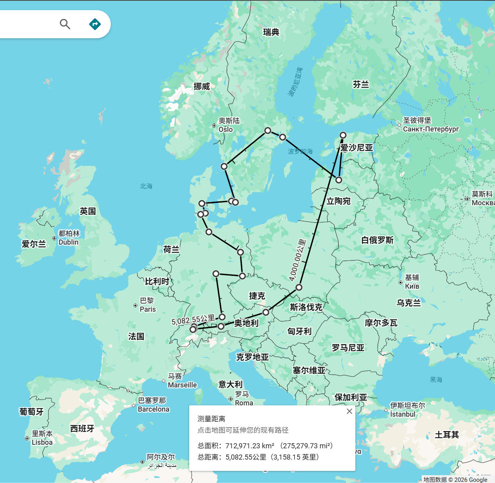

规划线路就是旅行快乐的一半。当我在纸上写下一串日期、地名、时间，盘点要带好欧元现金、药品、洗漱、转换头，再用斜线划掉几个之前的选项，<u>做出选择，练习取舍，踌躇满志，快然自足的时候，我的旅行便已先于物理时间开始了</u>。

德国由16个联邦州组成，整个地图像一张裙子。南边的慕尼黑是巴伐利亚州的首府，在德语里这里也被叫做拜仁。在二战后，为了逃离苏占区，很多公司和科学技术人才从北边的柏林和东部南迁，促成了巴伐利亚作为传统农业州的产业转型，现在已经变成一个坐拥宝马、奥迪、西门子等公司的科技强州。据说宝马的蓝白标，就是来自巴伐利亚州蓝白格子旗，BMW(Bayerische Motoren Werke AG)，翻译过来就是“巴伐利亚发动机制造厂“。\[1\] 在更早的时候，1623年，巴伐利亚因为清君侧平叛有功，从巴伐利亚公国晋升选侯国。\[2\] 现在去慕尼黑仍能看到王宫丰富的馆藏和广阔的王宫花园。

10月，秋意印染远处的山丘，近处的绿色田野上白雾迷蒙。汽车驶过博登湖，再过一两小时就到了慕尼黑。几乎每一个欧洲的城市，都会标配一块叫老城的区域，石子路步行街，广场-宫殿-教堂-市政厅。慕尼黑啤酒节刚过，这个节日据说源于庆祝巴伐利亚和萨克森的家族联姻，当地市民受邀的"坝坝宴"。慕尼黑喝酒的地方叫"啤酒花园"，基本元素是露天草坪上的长木桌和长凳，和一升的Maß大玻璃杯。老城的中心是Marienplatz，哥特风格的新市政厅，配上窗口的绿植，让人眼前一亮。朋友告诉我，在11点和12点，钟楼里的人偶，还会表演骑士比武和终结黑死病的街头庆典。巴伐利亚的出名饮食是烤猪肘、白香肠和啤酒。但若是运气不佳，为了一两块的小费，却也得当心穿着巴伐利亚格子衣服的服务员从Bavarian变成Barbarian。饭后朋友带我去英国花园散步，其得名于英式自然风景园林的风格，这是一片伊萨河(Isar)旁的长条绿地，当地人常在这里玩河流冲浪。

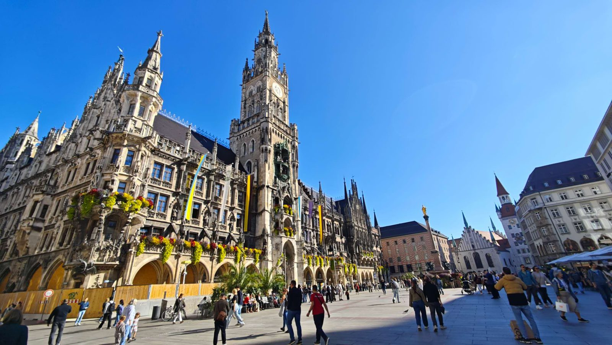
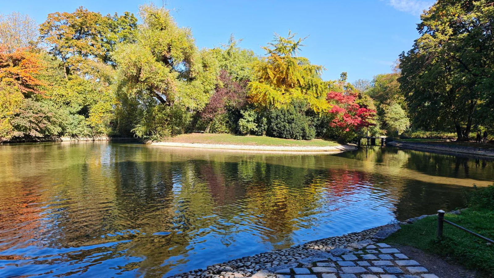
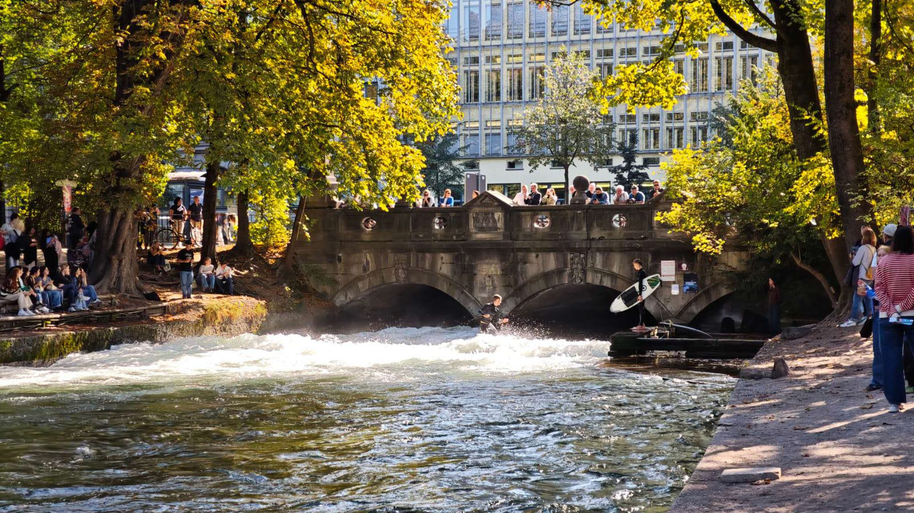

与朋友道别以后，我前往另一个"诸侯国"萨克森，首府是德累斯顿(Dresden)。萨克森是比巴伐利亚资格更老的选侯国创始成员。韦廷家族（Wettin）的萨克森公爵和波兰国王，以手折马蹄铁得名"强力王"的奥古斯特，作为法王路易十四的忠实粉丝，在这里大兴土木，将"凡尔赛宫"的建制搬到了易北河畔。巴伐利亚的王室，因为对古典希腊文化的推崇，将慕尼黑建成了"伊萨尔河畔的雅典(Isarathen)；而萨克森的王室，致力于将德累斯顿变成"易北河畔的弗罗伦萨"。除了辉煌的巴洛克宫殿，珍宝馆藏，皇家花园，奥古斯特还资助炼金术士破解了"制瓷"的奥秘，德累斯顿北部的小镇迈森(Meißen)，成为了欧洲瓷都。

火车从慕尼黑北上，经过纽伦堡，再向东经过莱比锡，到达德累斯顿已经是晚上了。中国的火车站命名通常是北站，东站，一个城市一个车站，而在欧洲，火车则常穿城而过，一座城市里常有多个车站，比如德累斯顿就分主站，中城(Mitte)和新城站。我在德累斯顿新城下车，这里是易北河的北岸，而南岸则是老城。虽叫新城，核心区的设计却在1732年完成，一条极宽的林荫大道从河畔的金色骑士塑像笔直通向阿尔伯特广场，透视出几何与秩序之美。在广场北部紧接一个充满生活气息的美食街区。当一份脸盆大的英杰拉饼伴随着一句热情的“Bitte schön”(请)被端上餐桌时，作为旅行者的某种特别感受在此刻被激起了。我尝试了一家厄立特里亚菜，厄立特里亚是北非红海边的国家，在一份尝起来略酸的松软多孔面饼上，铺着五颜六色的糊糊和蔬菜。传统的食用方法是不用任何餐具，而是用手捏住面饼抓起糊糊。青旅在欧洲似乎相当流行，旅行者需要自己套好床单、枕套等等，有经验的住客还会带一把小锁用于储物柜，一切都很干净。我整理好房间后出去转转，欧洲人的夜生活是怎么样的？不同于读到的柏林Techno电子舞曲和亚文化，德累斯顿的似乎更像学生街区。自行车搭着边包，若干年前下完晚自习的我也这样穿过有红绿灯的十字路口；青年靠在街道上充满涂鸦的木板床头；街巷酒馆的氛围和人群。朋友问我对德累斯顿的印象，我回答说many students alive 鲜活的人。

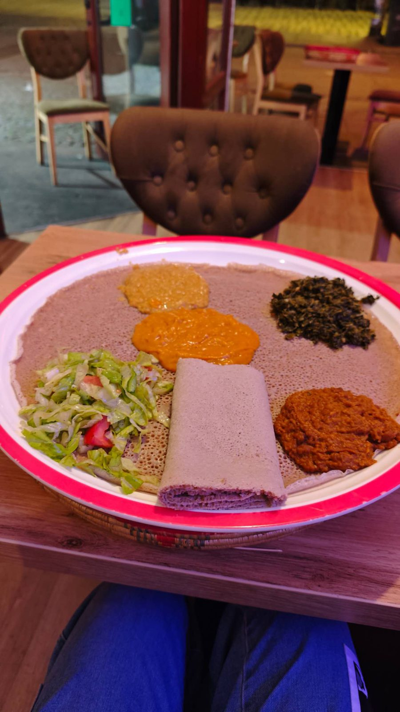
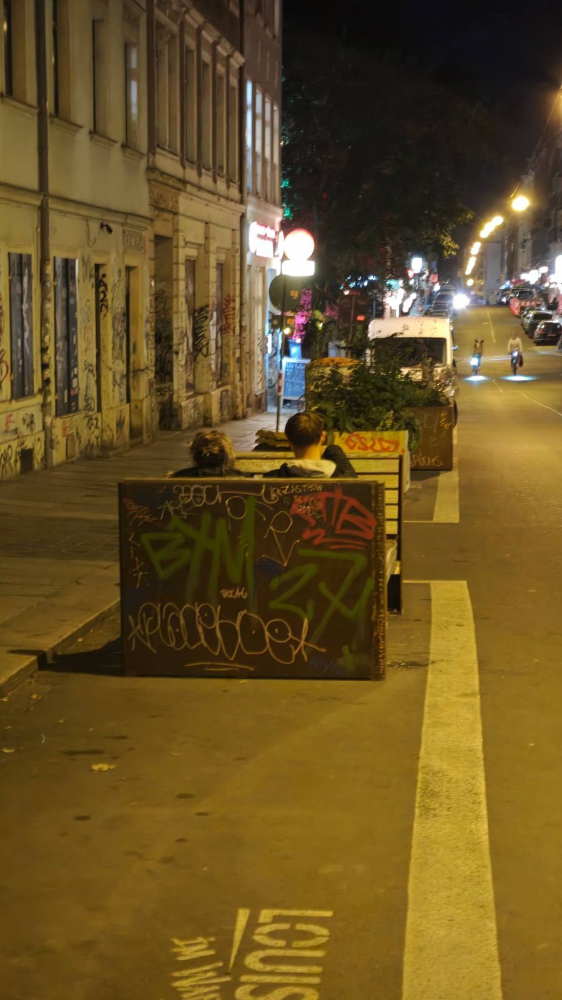

在二战后期，德累斯顿曾因英国皇家空军亚瑟哈里斯指挥的地毯式轰炸变成一片废墟。后来的重建大量使用了当时的原石残片，如今在重建的宫廷教堂等建筑表面，能看到大片大片的黑色印迹。或许在1945年的那个夜晚，这片水面也曾被燃烧的建筑映得绯红。如今它仍只是倒映着蓝天，倘若有黄色的电车从桥上驶过，它便也在波纹中映出虚幻的黄色影子。骑车或者跑步的人们从河边的步道或者滩涂经过。这种历史叙事与当今生活的立体展示，让我感到一种和谐。我在某些时刻，记录下这样的句子，<u>欧洲旅游，看查理，腓特烈，奥古斯特；看约翰，玛丽亚，圣方济各；也看穆勒，史密斯和安德森。他们代表了皇室王权，牧首教宗和市井大众。</u>

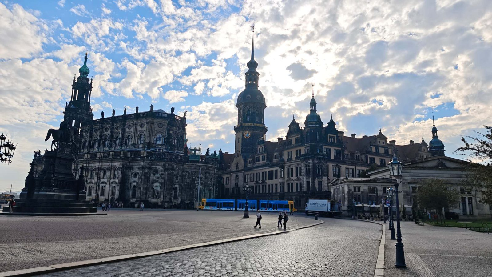
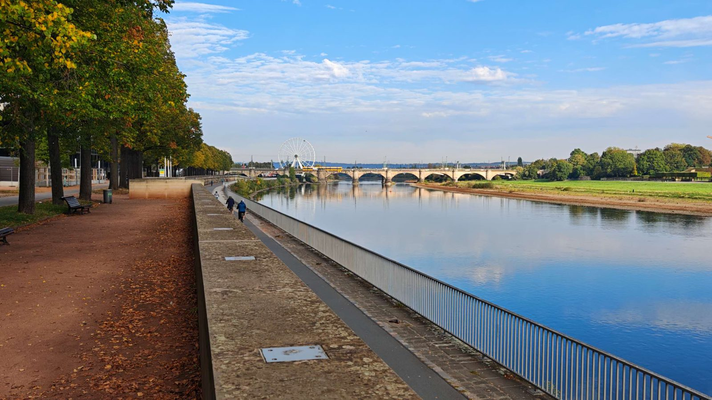

我的下一站是弗伦斯堡。火车从德累斯顿向北穿过德国腹地，到达汉堡的时候，因为晚点没能立刻接续下一班，我便在汉堡停驻。汉堡是德国第二大城市，易北河通向北海的入海口。汉堡有将近200万的人口，热闹的步行街，高楼和川流不息的宽阔马路，一种现代都市的感觉。从汉堡火车站出来，美术馆、歌剧院、易北音乐厅和仓库城(Speicherstadt)连成了一条环线。在Speicherstadt的铁桥上排满蓝绿橙红的小锁，东西方的人们用同样的方法表达长长久久愿望。在汉堡港前，是一段滨江长廊。夕阳，轮渡和步道上拍照的游客，让我忆起外滩也是这样，步道上游客们在栏杆前拍照。世界很大，但却常常有相似的感觉超脱距离的界限，让我常想是否有限的经历也能构建出对世界大体的刻画。走在汉堡的步道恍惚就像漫步黄埔滨江，这种感觉也曾在巴塞尔的莱茵步道出现；欧洲人吃肉桂卷，中国人吃花卷；一个在瑞典流行的哲学观念lagom，不多不少刚刚好，也曾在战国时代的庄子的著作中被表达。去过一些地方，如果我尝试做一种归纳总结，是否真的存在一组线性代数里的"基"来理解整个世界呢？数千年前的古人的答案是蝶与周，万物化而为一；于我，这种视野的建立，转化成一种保持欣赏的能力，一种边界无垠保持谦卑的提醒，一种"得以所见多"的幸运感和"我见过"的沉淀底气。

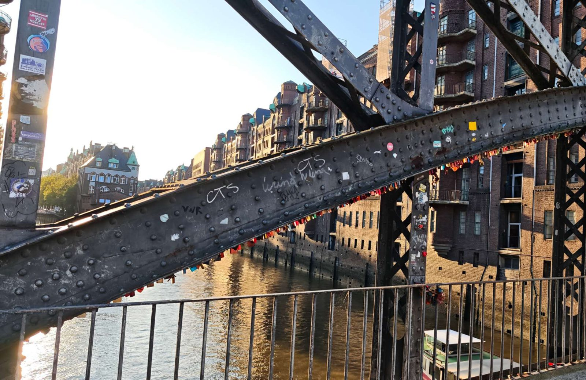
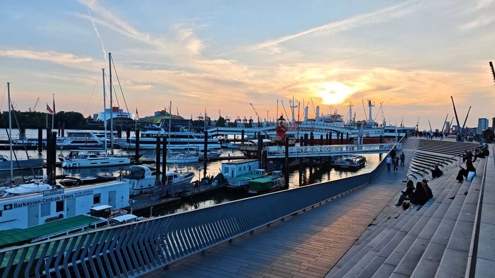

从汉堡到弗伦斯堡大约2小时车程，弗伦斯堡，北纬54度，这是我第一次走到比中国最北更北的地方。石勒苏益格-荷尔施泰因的第三大城市，曾是丹麦王国的领地，直到普鲁士-丹麦战争丹麦战败，这里成为德国的一部分。同汉堡一样，这里以贸易而兴，汉堡向西，通往北海，而弗伦斯堡向东，通过弗伦斯堡峡湾与波罗的海相连。在这里我交到了这趟旅程的第一个朋友。在从火车站去往市区的公交车上，我遇到了一位中国姐姐，年纪较我稍长。她觉着我亲切，便直接以"小兄弟"相称，对我热情关照，果然在海港边也不难找到江湖。弗伦斯堡房屋极有特点，一条步行街两旁有许多开口，开口进去则是小型的巷弄，三面围屋，这种结构叫做商人庭院，街面的店铺打理生意，从港口运来的货物则可通过后门运至仓储。来自加勒比海的蔗糖和原酒在这里加工调制，蒸馏成朗姆酒。酒精浓度在40左右，试着啜一小口，先有一阵陈甜，接着从咽部、食道到胃，感到有一条通路被热辣点亮。在阴雨连绵的北境之地，房屋多被刷上红黄蓝绿的鲜艳色调，他们既是木材防腐阻渗的护甲，也是唤醒人们感官和心灵的涤尘微露。我了解到姐姐来此访友，朋友是歌剧演员，平日排练，她便一人漫游。午后，她打算去森讷堡Sønderborg，我也欣然一同前往。

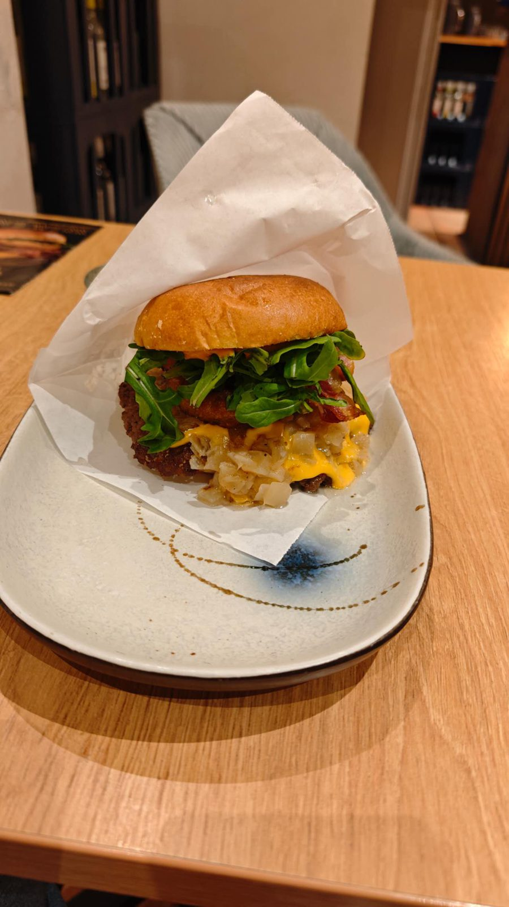
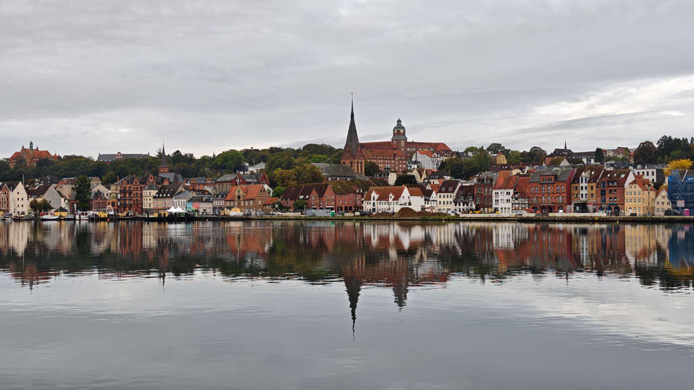
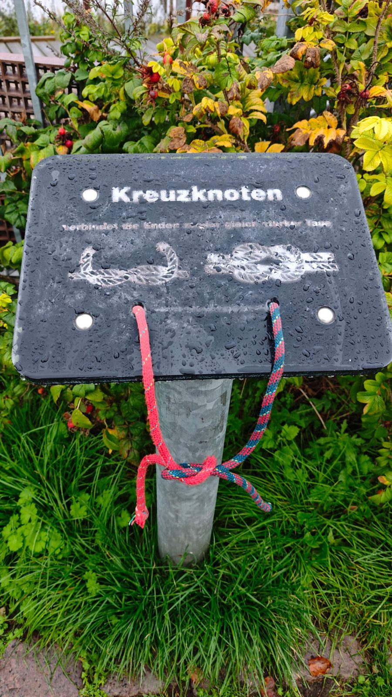

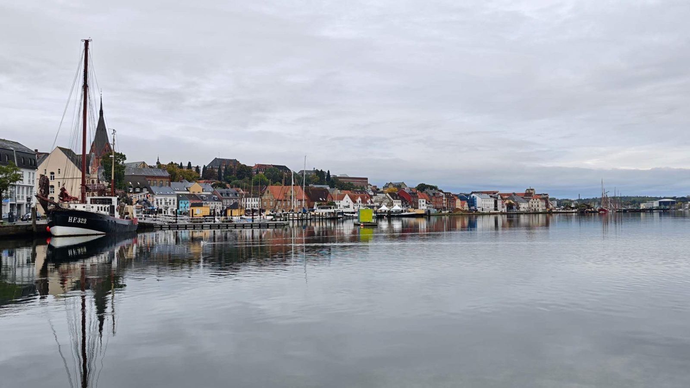
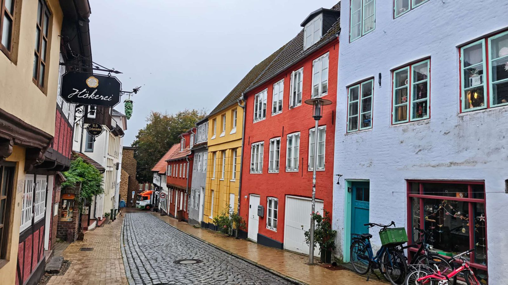

森讷堡是丹麦南部阿尔斯湾的一座城镇。海边的风猎猎地吹，浪潮把一些漂浮的淡红色水母送到岸边。在城市和海洋的边界有一处城堡，赭黄的外墙，橙红的顶，立在突出的地块上。不息的风拍松云块，蓝色从铅云中透出，树的影子铺在草坪上，绿开始变得鲜明温暖。待得阴晴几转，更多的蓝天露出来，整片大海变成澄澈的蓝，粼光泛泛，步道的外侧是海天无垠，内侧是几棵红果果树，学名花楸(qiū)，和几间售卖冰淇淋的小屋。朋友向我科普，穿着羽绒服吃冰淇淋是老外的文化传统。

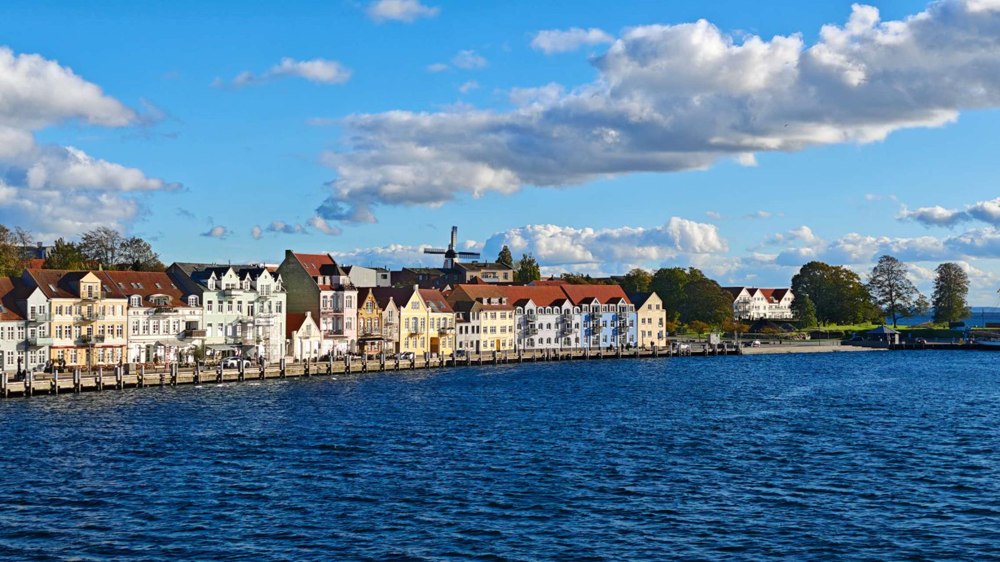
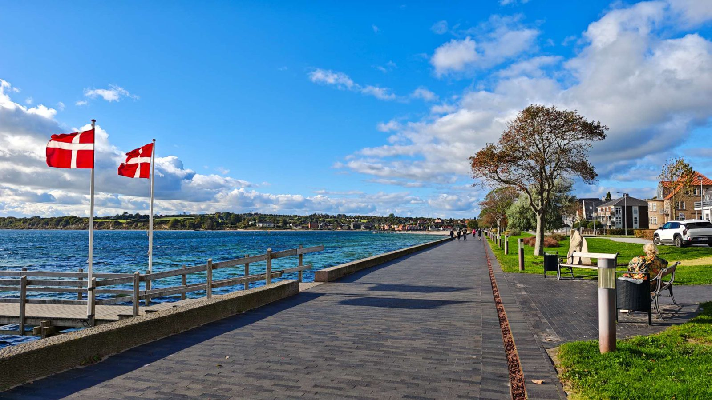

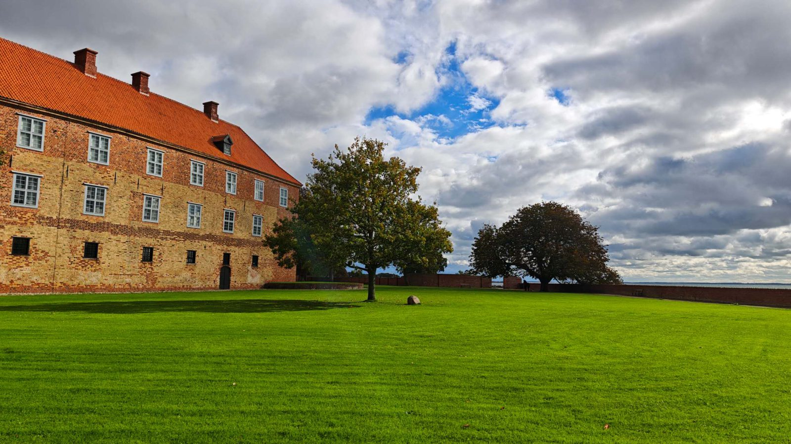

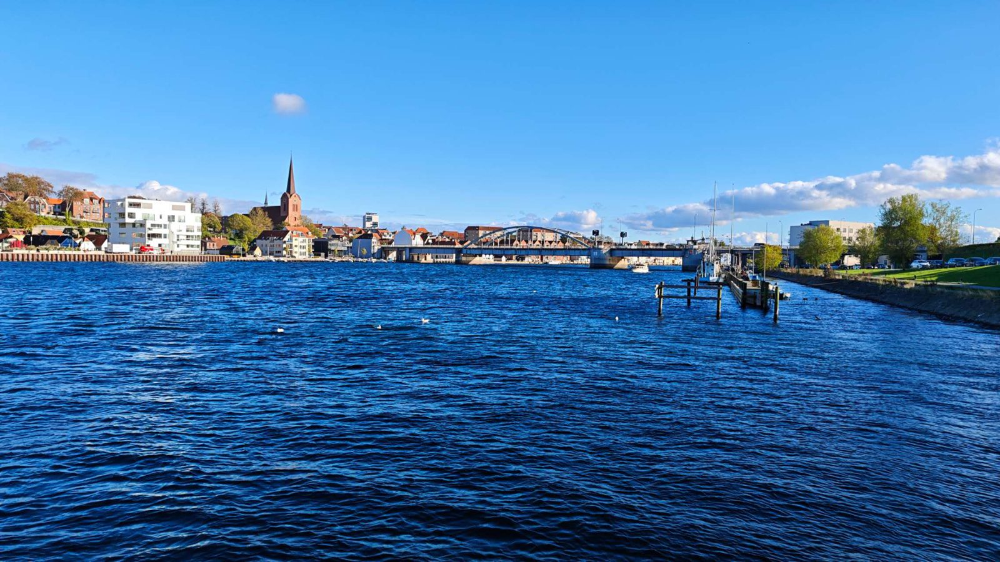

和朋友互相道别后，我启程前往哥本哈根。丹麦分为五个大区，有几个大岛，通过跨海大桥相连。最西边的叫日德兰半岛，中间是南丹麦大区菲英岛，最东边则是首都所在的西兰岛。在这里待的一两天，我尝试去感受哥本哈根的特质：设计、自然与幸福。有很多例子说明，一些特质常诞生于极性的环境，极性带来对比，就像篆刻的阴阳和沙丘上的手印，让一些东西比另一些更突出。在<u>阴雨连绵</u>的大西洋东岸，孕育了<u>色彩鲜艳</u>的斯堪的纳维亚美学；在北纬五十五度的<u>冰天雪地</u>里，发展出了丹麦人所崇尚的<u>温暖舒适</u>的生活哲学，他们叫做Hygge，就是壁炉，羊毛袜，热红酒和咖啡。在哥本哈根，感受设计感从一个氛围别致的高分青旅开始。利用石梁和绿植装饰外面，内饰是一些复古的机车，分类垃圾桶做成信箱模样。在这里，"连接"这一青旅社交属性得到极致伸展。在餐厅和吧台闲聊小酌，在游戏区竞一场桌上冰壶，或是在卡拉ok的沙发上听到1980年代的抒情歌曲(e.g. The Winner Takes It All)，再看世界各地的青年人一起喊着"low, low, low, low, low" (Flo Rida, Low)，再回到胶囊仓里度过一个安眠之夜。用过酸奶麦片加火腿土司的自助早餐，我在哥本哈根东北角的星形堡垒公园找到了自然和幸福的一面。矗立于水中高地的要塞被一条小河环绕，步道上大人带着小孩奔跑，在公园的另一侧，小美人鱼雕像向着外海的方向。在安徒生的想象中，人鱼化成了泡沫，丑小鸭变成了白天鹅，新年前夕的火柴，映出了远超丹麦四万平方公里地理区域的精神内核。走过色彩斑斓的新港，和砖红古朴的哥本哈根大学，我带上一份丹麦人日常的Hakkebøf (肉饼土豆)，跨过厄勒海峡，沿着瑞典西海岸一路北上，去往哥德堡。

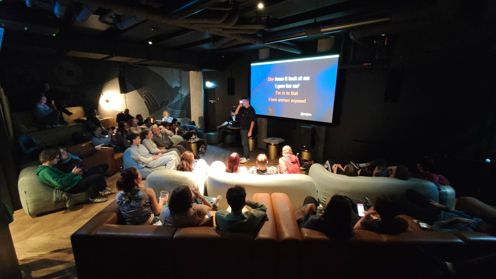
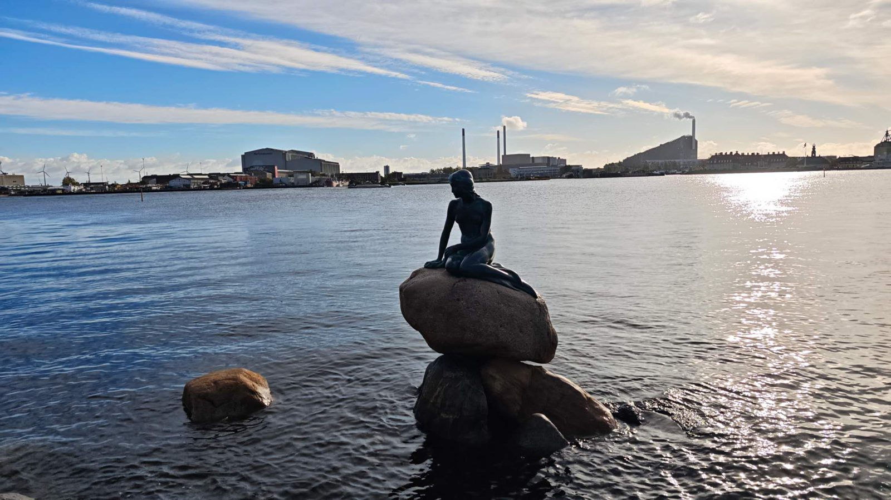
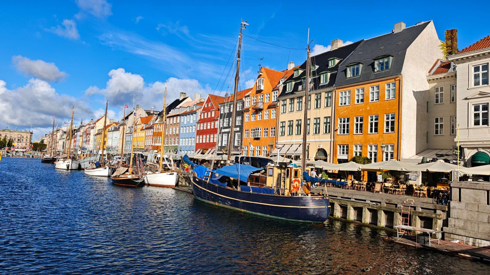

哥德堡(Göteborg)是瑞典的第二大城市，但实际读音却更像约特堡，而与巴赫的"哥德堡变奏曲"全无关系，那部巴赫的作品是为他学生Goldberg所写，只是中文同样译成了哥德堡。这里以fika文化著称。周六清晨，我去老城闲逛，昨夜才下完雨的湿气让让氛围显得静谧。横平竖直的街道上咖啡馆不少，上早班的却大多都只是橱窗内张贴的那张营业时间表。没能吃了"手掌大的肉桂卷"，也算是对瑞典人"工作以外"观念的真实体验了。我好奇去搜索一些"松弛的代价"，比如医疗系统非紧急病症长时的等待，因超长假期而缓慢的政务服务运转，在这个系统下，人们在得到更多自主时间的同时，也得被迫学会提前规划，自我疗愈。效率与精密，松弛与自由，不同的系统发展出不同的均衡。昨夜，同同住的一位住客聊天，他无奈地说到，在瑞典，各个地方的人们都往大城市去，斯德哥尔摩，而约特堡政府说要吸引二十万人就业，但房屋的供给还没跟上，他已在旅舍住了好几天。他是一个中提琴演奏者，在这里等待乐团演出的候补机会。"中提琴的声音很美"，我说到。他笑笑，"人们总这样说"。

我继续前往斯德哥尔摩。因为是瑞典首都，这里也被叫做斯京，位于在瑞典的东海岸。在瑞典的东西海岸之间，是大片的湖泊森林地貌。据说是早期，大地顶着厚厚的冰盖，而冰盖融化后，被压住的地壳反弹，把原来和大海相连的峡湾隔断形成堰塞，那些被冰川刨出的基坑又能兜住丰沛的降水，就形成了一个个湖泊。列车高速移动，窗外的雨迹在车窗上形成一股流线，火车减速，流线便失去托力而随之前移。到达斯德哥尔摩后，仍是阴雨，我便去博物馆躲雨。瑞典国家博物馆里正在展出的主题是画家们笔下的海边，其中一幅是莫奈的通向海边的路(Le Chemin de La Cavée, Pourville)。站在金色的画框前，我试着去描述一幅画，这里画着一簇草，是黄色的，忽然联想到一种嚼甘蔗的感觉。我试图想象艺术家们怎么在360度的全景观察中找到那一度的灵感和共鸣，而其他的359度又是怎样。下午五点，从展馆出来，斯德哥尔摩王宫和一众敦厚典雅的房屋与我隔河相望，河边的劲风让行人走得更快，仿佛这样的力也能施加在某个大钟的指针上而把时间拨快，北边的天快要黑了。整个斯德哥尔摩的市区常被形容成漂浮而相连的12座岛屿，按照攻略，北岛是通勤和白领上班的地方，有火车站，大学，中间是老城(Gamla Stan)，而南岛(Södermalm)更有生活的意味。于是我去南岛，寻找一些瑞典味道。在南岛，商店和餐馆沿一条南北主道分布。从交通轨道开始剖析城市分区，是我城市探索的经验，从地图上点击中央车站显示的地铁网络，往往也直接展示了这个城市的流量脉络。同丹麦一样，这里常见的饮食元素也是土豆、肉丸，以前在苏黎世的时候，室友与我去宜家时，他便爱点瑞典肉丸。第二天在几个斯德哥尔摩标志性的彩色地铁站打卡以后，我会去到波罗的海另一侧。

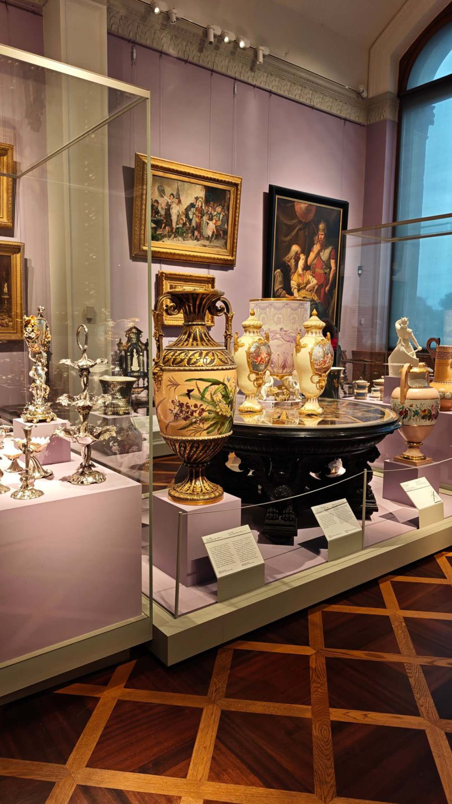
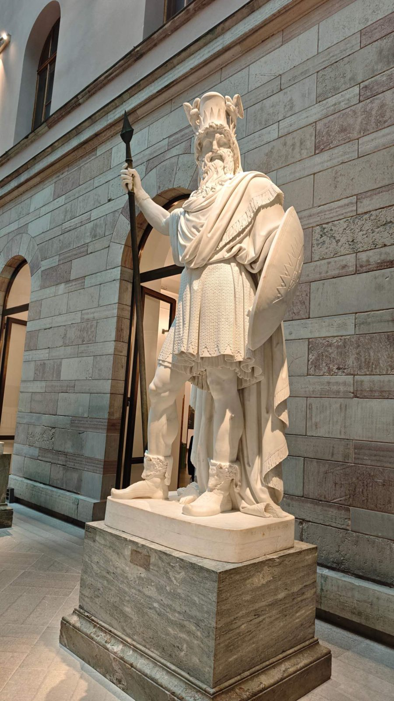
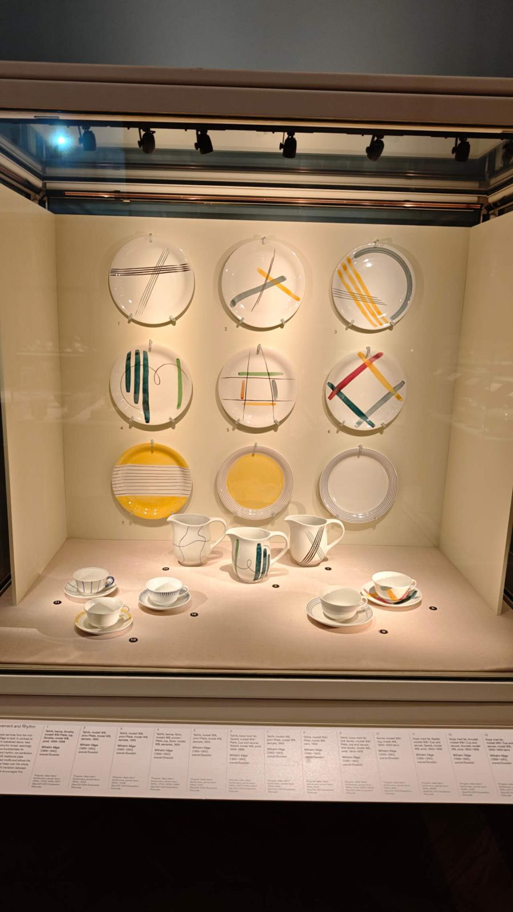
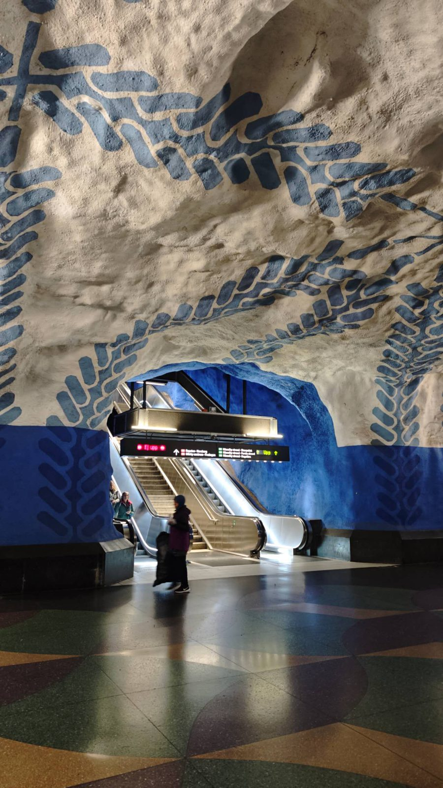

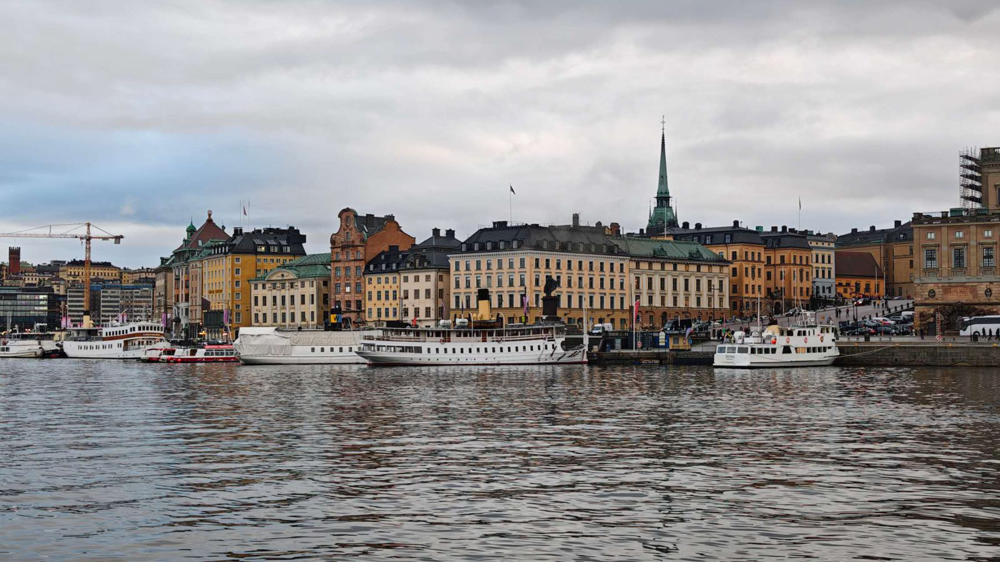

大约飞行1小时，就从斯德哥尔摩到了里加，拉脱维亚的首都。同德累斯顿一样，里加的城中央也有一条分隔两岸的河流，机场所在的西岸是现代建筑，坐40分钟汽车向东跨过道加瓦河(Daugava)，就到了东岸的历史老城。老城被步行街组成的网格切成豆腐块，在步行街的一侧是一个街心公园，绿树成荫，有一条从海里引入的城市运河曲折其间，拉脱维亚大学和国家歌剧院在公园的两侧。在东方的公园里，常有一些亭台轩榭，回廊假山，西方则更多运用自然的元素，粗壮的大树，溪流和绿地。下着小雨的夜晚，我打着伞在这个新的城市探索。某个拐角有一扇厚重的木门，上面是藤条，两旁是盾牌和旗帜，近看盾牌上写着中世纪餐厅。我走进里面，昏暗的灯光照着木橱上的瓶瓶罐罐，旋转楼梯和地堡的入口相连。拱券下的悬灯和桌上的蜡烛把地堡空间分成小块，侍者着中世纪风格的白帽宽袖长袍，外套一件绿色披挂。离这不远，还有一家类似风格的黑魔法酒吧，架子上陈列着炼金术士的红色、棕色的锥形瓶和烧瓶，一些倾倒或叠放的厚书。一杯黑魔法药酒和一颗松露巧克力，在细长的蜡烛的火光燃起的轻烟里，似乎正在倒带剑光冷泛的王权密谋；周围优雅醇厚的英伦腔调，或许正决定着数千公里外的家族兴衰。翌日清晨，我从阿尔伯特大街"新艺术运动"的建筑外墙走过，许多人头和卷曲的外墙装饰是这类风格的特点，斯德哥尔摩经济学院的里加校区也坐落于此，应苏联解体后社会经济向市场经济转轨的历史使命而建。接着在里加的中央市场，人们交易海的赠与。最常见的是鲱鱼(Herring)，带一点烟熏风味。还有咸干鱼，想起小时候家里把晾完的袜子叫做干鱼，确觉形象。我打开AI开始水产科普，黄色的是鲭鱼，深红色的是鳟鱼子，扁平的是鱿鱼片，还有脂质十足的橙色三文鱼卷。我也了解到一些关于波罗的海的知识，由于它仅依靠丹麦的窄入口与大西洋交换海水，水体更新缓慢，周围大量淡水河流的注入，较低的蒸发水平，让波罗的海成为了世界上盐度最低的海。确有一些水体污染的担忧，不过作为游客尝鲜却也无虞。我买了一个三文鱼卷，再带上一个牛肉薄饼，下一站是塔林。

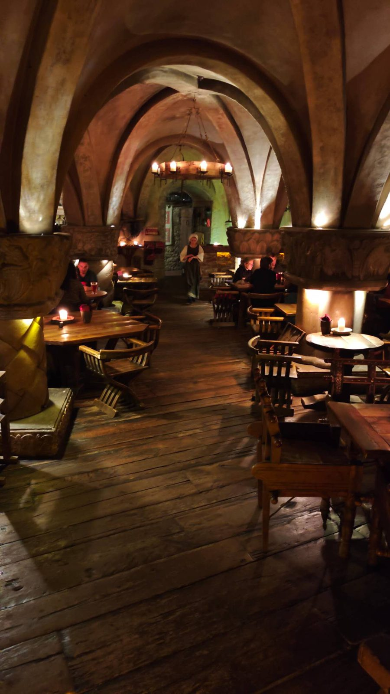
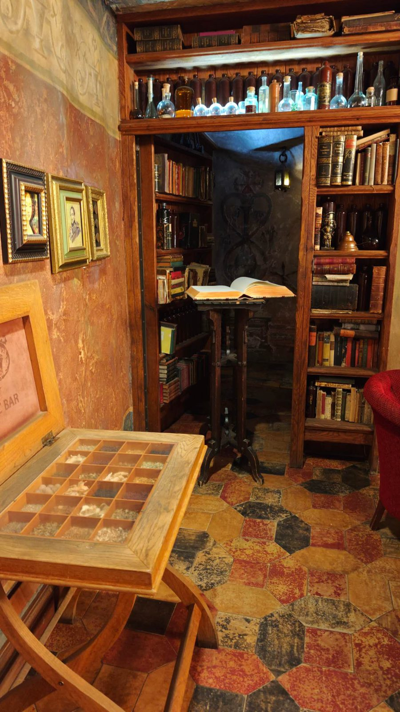
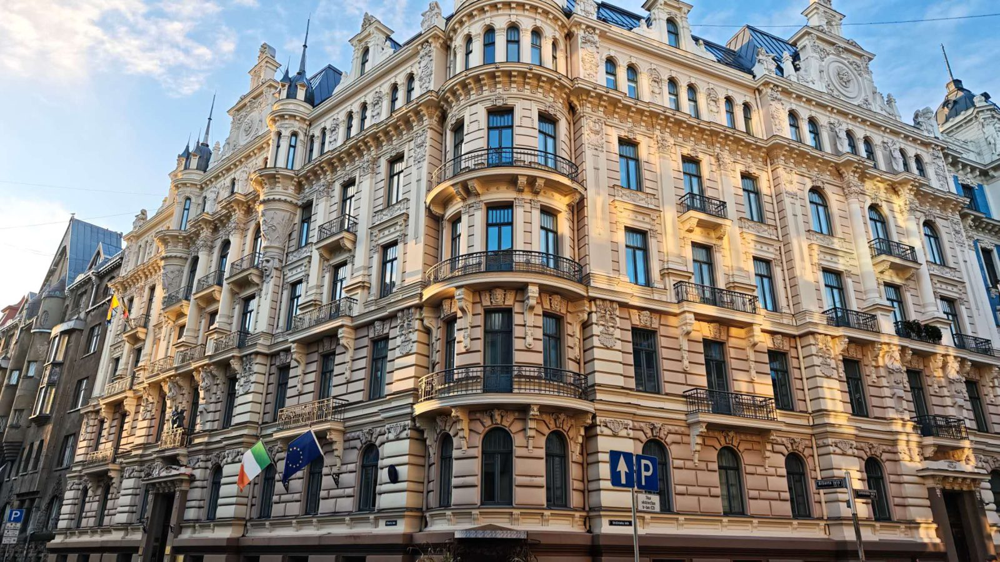

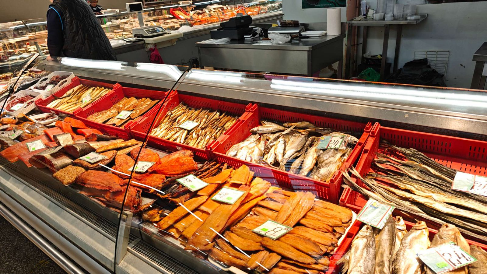

<video controls="True" playsinline="True" preload="metadata" src="media/8SRAN5T24I6p.mp4"></video>

从里加到塔林是六个小时车程，且一天的班次不多，我在中午的时候启程。天气很好，在蓝天下，黄色的叶仍是灿烂明艳。到了塔林车站，穿过一个大公园，就到了塔林的老城，石屋，石墙和石子路铺开这里的中世纪底色。第二天，我在超市买了一些牛奶焦糖toffee作为伴手礼，据说这是经典的苏联味道。在城西的座堂山小丘，有一个路德宗的圣母教堂和一个东正教的洋葱头教堂。早期的丹麦人引入了罗马天主教，后来这里又被瑞典统治，转为新教，再晚一些爱沙尼亚又被俄国沙皇统治，东正教信仰被大力推行。

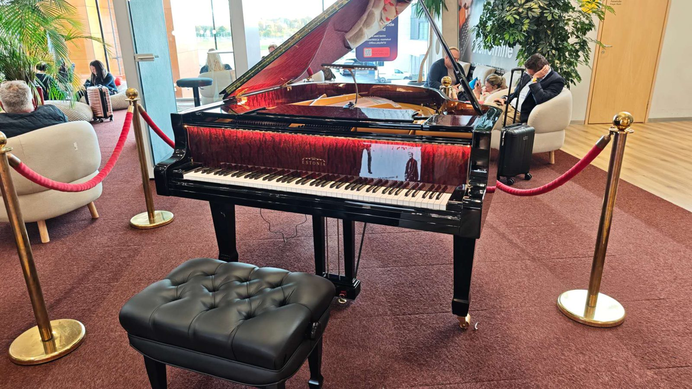

中午我在老城找了一家煎饼铺，等待排位时，遇到两位女士一起拼桌，她们分别来自法国和德国。法国的安妮和我闲聊起来，问我的旅行计划，很有礼貌地接上一句"如果您愿意谈论的话"，后来我了解到她们是一个法律检察系统的学习小组，在此工作午餐，我开玩笑说，我应该从"保持沉默的权力"立刻猜到您的职业。她大笑，临别时送了我一盒布列塔尼Vendee的法式海盐焦糖。从餐厅出来后，我注意到一条航班调整的消息，我本计划从塔林乘航班去维也纳，但中途转机前程的航班延误导致后面无法接续，克拉科夫便这样被加上了旅行清单。塔林机场的开放钢琴让等待不那么无聊，我学了一段德彪西的阿拉伯风，在夜幕降临以后落地克拉科夫，今晚就在这里暂住一晚。

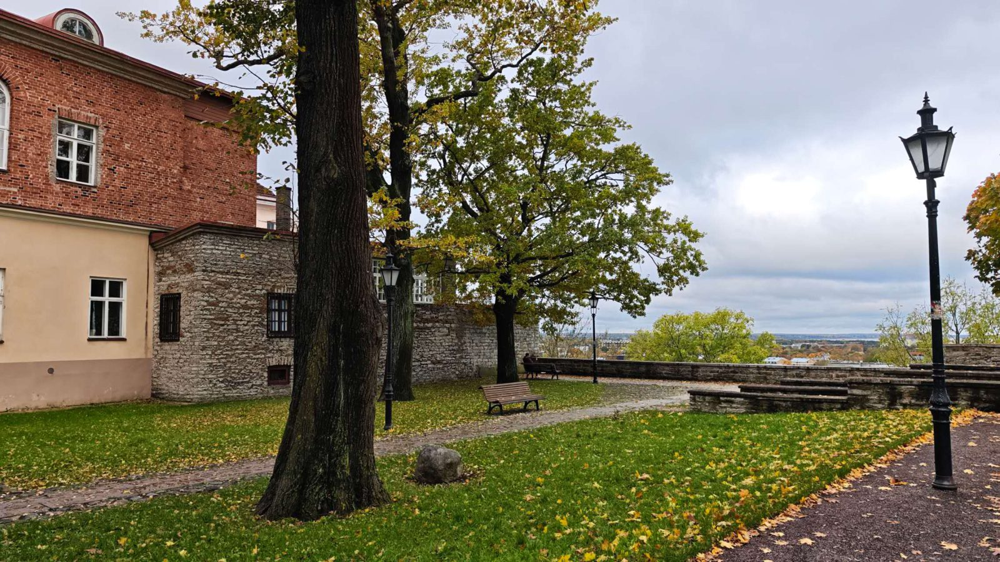
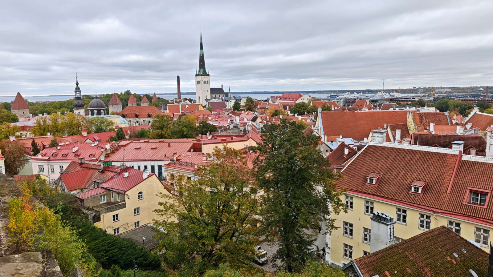

克拉科夫Krakow是波兰南部的大城市，曾作为波兰的首都。在这次旅行中，我有许多超市购物的好经历，在斯德哥尔摩的超市买到的肉桂卷面包，在塔林超市的牛奶焦糖和烤披萨饼都让我印象深刻，改变了我对标准化产品的一些观念，于是我也在这里的超市买了一盒波兰饺子。老城的中心是集市广场Rynek Główny，周围的建筑方正典雅。老城的外围是公园，宽阔笔直的道路两旁绿树成荫，再往外，则有一条维斯瓦河(Vistula)从城中流过。清晨，蓝天投影在河面，渲染成天空之境的感觉。在城中闲逛一会儿，我坐车前往旅行的最后一站，音乐之都维也纳。

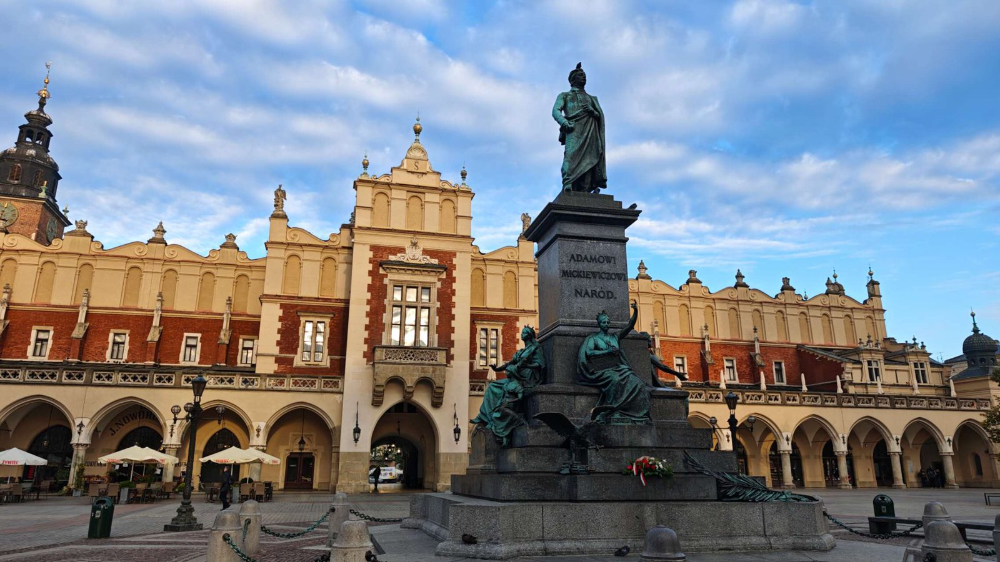
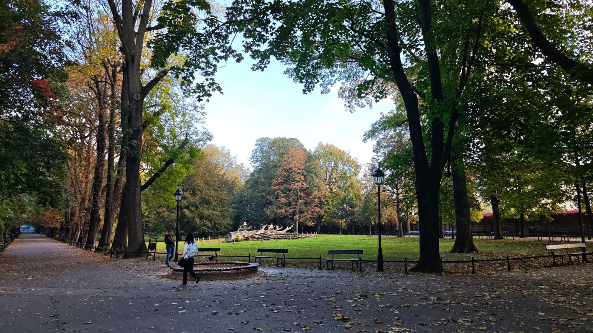

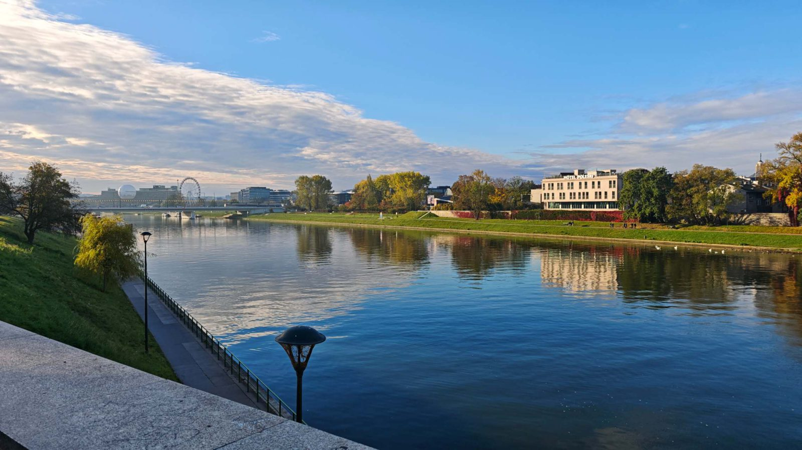

到这以后，第一感觉是这是一个"生活城市"，在下午5点坐地铁竟赶上了久违的下班"晚高峰"。维也纳有两百万人口，是苏黎世的四倍，哥本哈根的三倍。朋友在这里念博士，带我参观了大学校园后，我们又在Prater大公园里宽阔的马路上散步，叙旧聊天；朋友招待我晚饭吃了烤鱼，我把从哥本哈根带的明信片相赠，美名曰学术交流。在维也纳，一些经典的歌剧，卡门，塞维利亚理发师等，每天都在上演。第二天一早，我去了市中心的卡尔广场，但金色大厅作为音乐家们的办公场所，却只有在下午导览时刻和晚上的演出时段向公众开放，一旁的卡尔教堂也在修葺。我站在街头，车辆来往，忽然一股怪诞的力量在心里，要不现在回去了吧。教堂，美景宫花园里的玫瑰，还有更多绚烂辉煌的建筑，他们一直在那里。在维也纳的咖啡馆喝一杯咖啡也不是必要的了。旅行应该要看些什么呢？旅行应该期待什么呢？我想起在斯德哥尔摩的旅店，我听人们聊天，从一系列'but'而略带委屈的语调中，我分辨或许有一半的旅人也未必是充满希望与向往的，人们因为各种各样的原因，处在各种各样的地方。当我觉得这趟出来得够久了，那就返回吧。电车是火车站的方向，我在车站的超市买了一份维也纳肉排和烤猪肘。火车一路向西，经过萨尔兹堡，经过因斯布鲁克，在风光秀丽的因河河谷，有很多秋天也不会黄叶的常青树。在回埃格里的山路上，绚丽的晚霞染红高空，更高处是深邃的蓝，皎月下的楚格湖畔星星点点。

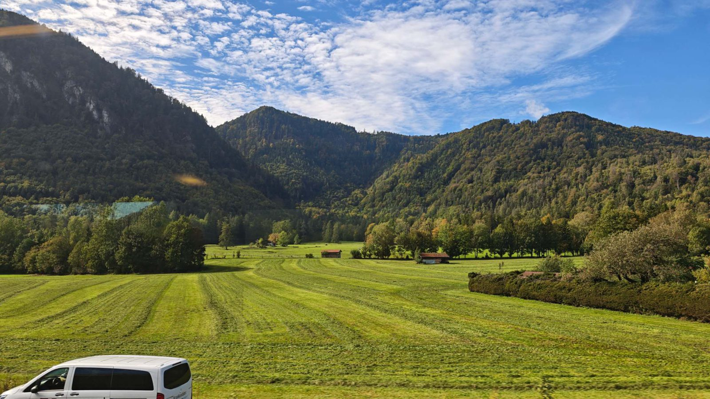
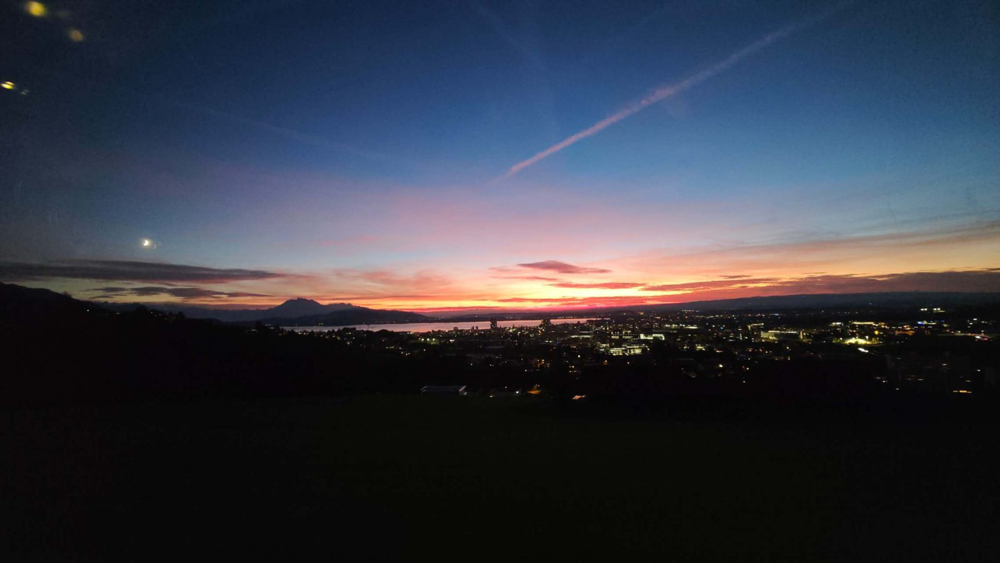

【I 之终】

II 利古里亚，托斯卡纳 意大利

在几个星期以后，我来到了意大利。

III 希腊雅典

【选帝侯的故事】

【维特尔斯巴赫家族的故事(巴伐利亚和普法尔茨)】

【慕尼黑疯王新天鹅堡】

【狮子亨利的故事，慕尼黑和吕贝克南北双城】

【慕尼黑市政厅的壁钟】

中世纪骑士婚礼，库伯勒舞，鼠疫

【城市历史 · 慕尼黑】

【萨克森的故事】

【欧洲人名的故事】

【北欧房子颜色，石头的故事】

【汉萨商人的故事】

【丹麦王国，丹麦和普鲁士战争】

【六大基酒】

【丹麦语，瑞典语】

【植物，花楸】

【北欧食物】

【里加历史】

- 16世纪至17世纪曾先后受波兰立陶宛联邦和瑞典帝国统治。
- 18世纪的大北方战争后，里加于1721年被并入**俄罗斯帝国**，并迅速发展为沙俄帝国在波罗的海沿岸西北部的主要军港与商业枢纽

【波兰历史】

艺术

番外篇
