最初我想写的题目是 “城市性格”，以前我所写的，大都写一些瑞士阿尔卑斯自然景色的篇章，这次，我想去感受城市。在临行之前的想象，我会坐在某个广场的咖啡馆，遮阳棚向外支出，广场中央有一块石碑，人们沿着斜线走过。每个城市都有不同的性格，有的热烈直接，有的则需要慢慢感受。

旅行的规划和执行做得很成功。旅行结束，银行卡和护照还在，有一多半的蓝天，我已应足够感激。但我觉得不够高兴，甚至有点疲乏，我似乎没有学会怎么去欣赏旅行中的遇见，我在10天没看电脑以后仍然觉得脖子不适，优越和受挫激发的攻击性仍像段誉未精熟的六脉神剑不受控地发出，我一坐回我的座位仍然自动地翘起二郎腿，好像一切都没有改变。我大概也很难写出"城市性格"。

我想了一些其他的副标题， \
---"当我旅行时，我在想些什么"， \
---"作为旅行家的我"， \
---"我与AI的聊天记录"。

无论怎样，我总会写些什么，我享受这个过程，舒适的字号和间距，好像反刍的动物去吃米其林餐厅半价打折一样，记忆之河从头缓缓流淌，碰到的元素被一盏盏点亮。我在准备和旅程的过程中问过AI很多不同的事，{巴伐利亚和萨克森，选帝侯}，{朗姆酒，Burek和鲱鱼}，{新艺术运动，瑞典国家博物馆的镇馆之宝}，{维也纳和塔林的人口数量，波罗的海鱼类污染}，{安徒生童话和卡门的观剧指南} …. 像拿起一串葡萄，旅行是茎，在这串茎上挂缀着果实。

很早，5：20，我从埃格里出发，坐上前往楚格的601路。因为第一次去找flixbus的长途车站， 我决定早点走，从苏黎世去慕尼黑的大巴早上7点出发。在这么早的车上，已经七七八八坐上了人，其中一个拿着一个大的Lidl口袋，看起来像是去上班的人。在火车站的站台上，一个小女孩在她的行李箱旁手舞足蹈兴奋不已，我想，人们或许一年也不会旅行几次，那与一起选择今天出行的人们，算是与有荣焉了。

同事建议我坐大巴去慕尼黑，因为德国铁路经常晚点，大巴反而更快。我提前买了票，从苏黎世到慕尼黑，20欧元。我这次的旅行，是有点雄心的，我打算从苏黎世出发，去德累斯顿，一个在我的想象中和金光泛泛的铜管和厚重的石块的联系起来的城市，然后再一路北上，去德国地图上最北的弗伦斯堡，去丹麦的哥本哈根，瑞典的斯德哥尔摩，再飞到波罗的海的东岸，去拉脱维亚里加，爱沙尼亚塔林，再南下到维也纳，从东边回到瑞士。

规划线路就是旅行快乐的一半。当我在纸上写下一串日期、地名、时间，盘点要带好欧元现金、药品、洗漱、转换头，再用斜线划掉几个之前的选项，做出选择，练习取舍，踌躇满志，快然自足的时候，我的旅行便已先于物理时间开始了。

德国由16个联邦州组成，整个地图像一张裙子。南边的慕尼黑是巴伐利亚州的首府，在德语里这里也被叫做拜仁。在二战后，为了逃离苏占区，很多公司和科学技术人才从北边的柏林和东部南迁，促成了巴伐利亚作为传统农业州的产业转型，现在已经变成一个坐拥宝马、奥迪、西门子等公司的科技强州。据说宝马的蓝白标，就是来自巴伐利亚州蓝白格子旗，BMW(Bayerische Motoren Werke AG)，翻译过来就是“巴伐利亚发动机制造厂。在更早的时候，1623年，巴伐利亚因为清君侧平叛有功，从巴伐利亚公国晋升选侯国。现在去慕尼黑仍能看到王宫丰富的馆藏，对称的王宫花园。

10月，秋意印染远处的山丘，近处的绿色田野上白雾迷蒙。汽车驶过博登湖，再过一两小时就到了慕尼黑。欧洲几乎每一个城市，都有一块叫老城的区域，石子路步行街，广场宫殿教堂市政厅。慕尼黑啤酒节刚过，这个节日据说源于庆祝巴伐利亚和萨克森的家族联姻，当地市民受邀的"坝坝宴"。慕尼黑喝酒的地方叫"啤酒花园"，基本元素是露天草坪上的长木桌和长凳，和一升的Maß大玻璃杯。老城的中心是Marienplatz，哥特风格的新市政厅，配上窗口的绿植，让人眼前一亮。朋友告诉我，在11点和12点，钟楼里的小人，还会表演骑士比武和终结黑死病的街头庆典。巴伐利亚的出名饮食是烤猪肘、白香肠和啤酒。但若是运气不佳，为了一两块的小费，却也得当心穿着巴伐利亚格子衣服的服务员从Bavarian变成Barbarian。饭后朋友带我去英国花园散步，这是一片伊萨河旁的长条绿地，当地人常在这里玩河流冲浪。

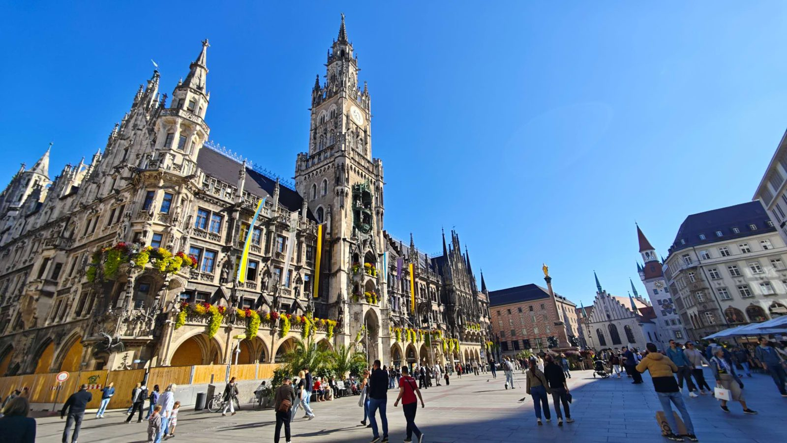
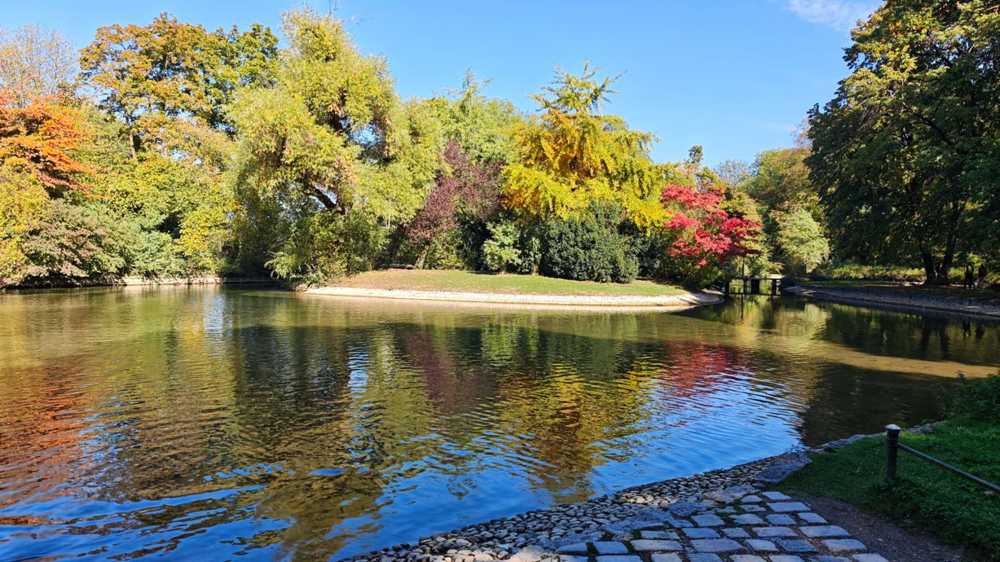
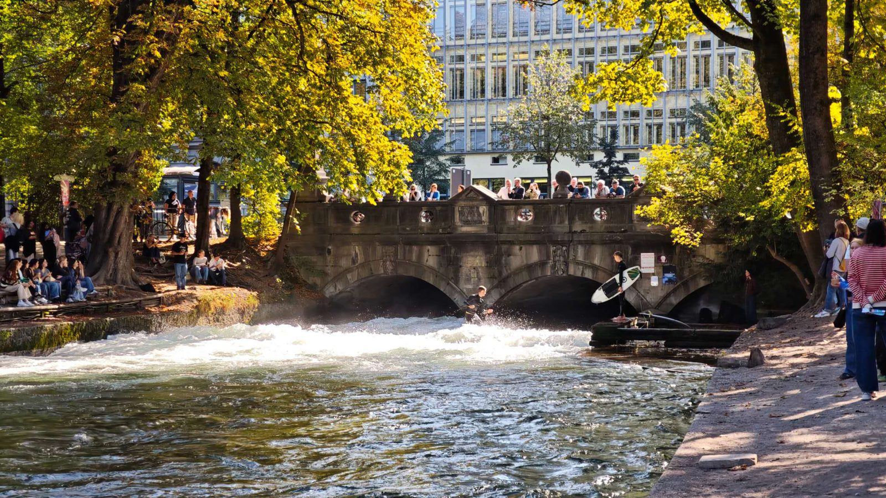

与朋友道别以后，我前往另一个"诸侯国"萨克森，德累斯顿Dresden。萨克森是比巴伐利亚资格更老的选侯国创始成员，韦廷家族（Wettin）的萨克森公爵和波兰国王，以手折马蹄铁得名"强力"的奥古斯特，作为法王路易十四的忠实粉丝，在这里大兴土木，将"凡尔赛宫"的建制搬到了易北河畔。巴伐利亚的王室，因为对古典希腊文化的推崇，将慕尼黑建成了"伊萨尔河畔的雅典(Isarathen)；而萨克森的王室，致力于将德累斯顿变成"易北河畔的弗罗伦萨"。除了辉煌的巴洛克宫殿，珍宝馆藏，皇家花园，奥古斯特还资助炼金术士破解了"制瓷"的奥秘，德累斯顿北部的小镇迈森，成为了欧洲瓷都。

火车从慕尼黑北上，经过纽伦堡，再向东经过莱比锡，到达德累斯顿已经是晚上了。我在德累斯顿新城下车，这里是易北河的北岸，而南岸则是老城。虽叫新城，核心区的设计却在1732年完成，一条极宽的林荫大道从河畔的"金色骑士"奥古斯特塑像笔直通向阿尔伯特广场，透视出几何与秩序之美。紧接一个充满生活气息的美食街区。我必须承认，当一份脸盆大的英杰拉饼伴随着一句热情的“Bitte schön”(请)被端上餐桌时，作为旅行者的某种特别感受被激起了。这是厄立特里亚菜，厄立特里亚是北非红海边的国家，在一份尝起来略酸的松软多孔面饼上，铺着五颜六色的糊糊和蔬菜，传统的食用方法是不用任何餐具，而是用手捏住面饼抓起糊糊。旅行的第一晚是一家Hostel的四人间，也是我第一次青旅的尝试。这在欧洲似乎相当流行。我需要自己套好床单、枕套等等，有经验的住客还会带一把小锁用于储物柜，一切都很干净。我出去转转，欧洲人的夜生活是怎么样的？不同于读到的柏林Techno电子舞曲, Sex-positive性积极和亚文化，德累斯顿的似乎更像学生街区。自行车搭着边包，若干年前下完晚自习的我也这样穿过有红绿灯的十字路口；男生和女生靠在街道上充满涂鸦的木板床头；街巷酒馆的氛围和人群。朋友问我对德累斯顿的印象，我回答说many students alive. (鲜活的人)。

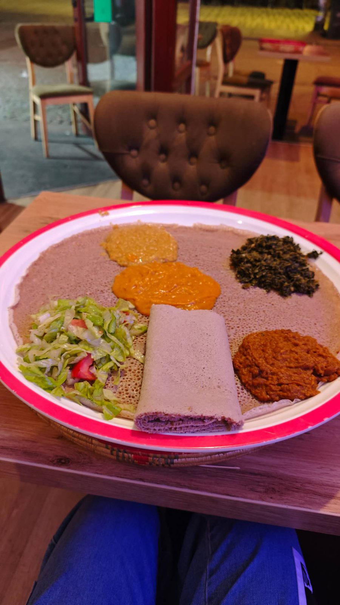
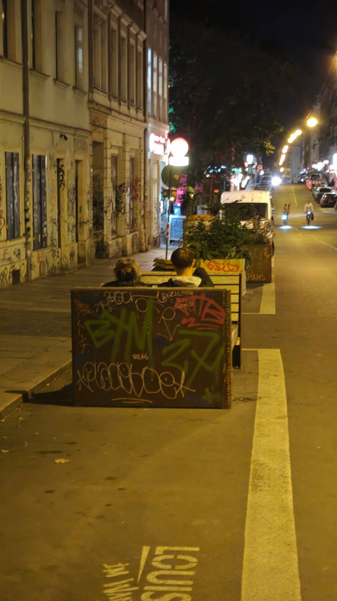

在二战后期，德累斯顿曾因英国皇家空军亚瑟哈里斯指挥的地毯式轰炸变成一片废墟。后来的重建大量使用了当时的原石残片，如今在重建的宫廷教堂等建筑表面，能看到大片大片的黑色印迹。或许在1945年的那个夜晚，这片水面也曾被燃烧的建筑映得绯红，而如今它仍只是倒映着蓝天，倘若有黄色的电车从桥上驶过，它便也在波纹中映出虚幻的黄色影子。骑车或者跑步的人们从河边的步道或者滩涂经过。这种历史叙事与当今生活的立体展示，让我感到一种和谐。我在某些时刻，记录下这样的句子，欧洲旅游，我看查理，腓特烈，奥古斯特；看约翰，玛丽亚，圣方济各；也看穆勒，史密斯和安德森。他们代表了皇室王权，牧首教宗和市井大众。

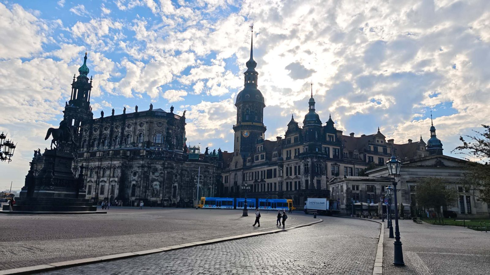
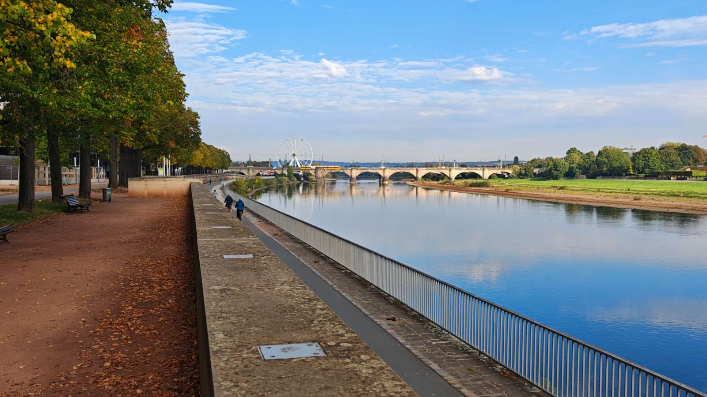

我的下一站是弗伦斯堡。火车从德累斯顿向北穿过德国腹地，到达汉堡的时候，因为晚点不能立刻接续下一班，我便在汉堡停驻。汉堡是德国第二大城市，易北河通向北海的入海口。汉堡有将近200万的人口，热闹的步行街，高楼和川流不息的马路，营造出现代都市的感觉。从火车站出来，美术馆、歌剧院、易北音乐厅和仓库城连成了一条环线。在Speicherstadt的铁桥上排满蓝绿橙红的小锁，东西方的人们用同样的方法表达对长长久久的追求。在汉堡港前，是一段滨江长廊。夕阳，轮渡和步道上拍照的游客，让我忆起外滩也是这样的步道，游客们也是这般在栏杆前拍照。世界很大，但却常常有相似的感觉超脱距离的界限。走在汉堡的步道恍惚就像漫步黄埔滨江，巴塞尔的莱茵河步道也是这样；欧洲人吃肉桂卷，我也曾这样掰开吃花卷；一个在瑞典流行的哲学观念lagom，不多不少刚刚好，也曾在战国时代的庄子的著作中被表达。去过一些地方，我有了一种归纳总结的能力，是否真的存在一组"基"来理解整个世界呢？数千年前的古人的答案是蝶与周，万物化而为一；于我，这种视野的建立，转化成一种保持欣赏的能力，一种边界无垠保持谦卑的提醒，一种"得以所见多"的幸运感和"我见过"的底气。

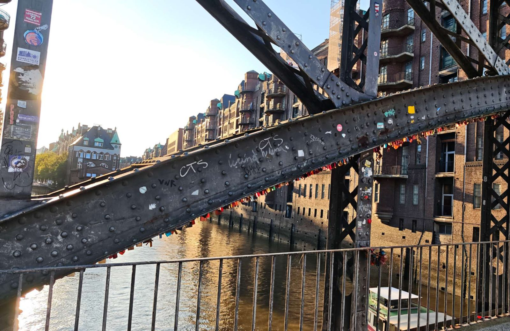
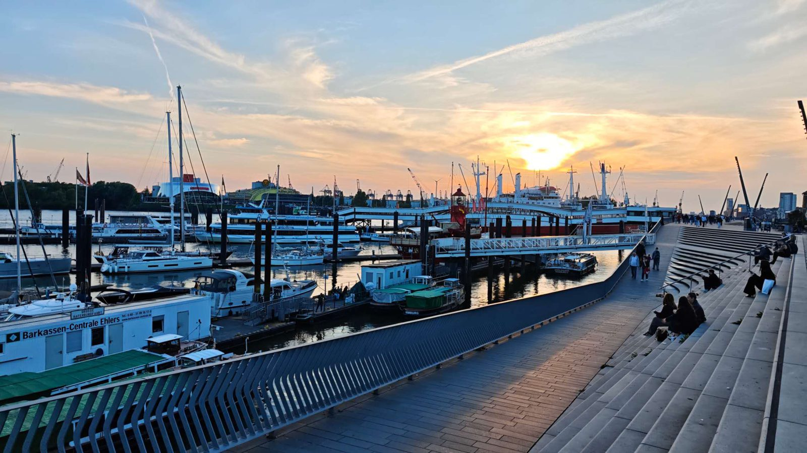

从汉堡到弗伦斯堡大约2小时车程，弗伦斯堡，北纬54度，这是我第一次走到比中国最北更北的地方。石勒苏益格-荷尔施泰因的第三大城市，曾是丹麦王国的领地，直到普鲁士-丹麦战争丹麦战败，这里成为德国的一部分。同汉堡一样，这里以贸易而兴，汉堡向西，通往北海，而弗伦斯堡向东，通过弗伦斯堡峡湾与波罗的海相连。在这里我交到了这趟旅程的第一个朋友。在从火车站去往市区的公交车上，我遇到了一位同乡，年纪较我稍长。她觉着我亲切，便直接以"小兄弟"相称，对我热情关照，果然在海港边也不难找到"江湖"。弗伦斯堡房屋极有特点，一条步行街两旁有许多开口，开口进去则是小型的巷弄，三面围屋，这种结构叫做商人庭院，街面的店铺打理生意，从港口运来的货物则可通过后门运至仓储。来自加勒比海的蔗糖和原酒在这里加工调制成朗姆酒。在阴雨连绵的北境之地，房屋多被刷上红黄蓝绿的鲜艳色调，他们既是木材防腐阻渗的护甲，也是唤醒人们感官和心灵的涤尘微露。我了解到姐姐来此访友，朋友平日工作，她便一人漫游。她打算去森讷堡，我也欣然一同前往。

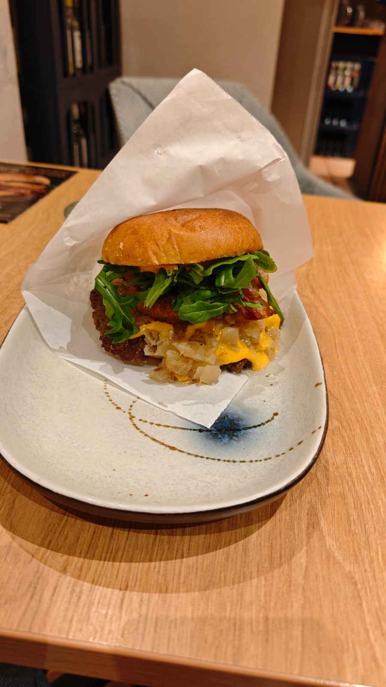
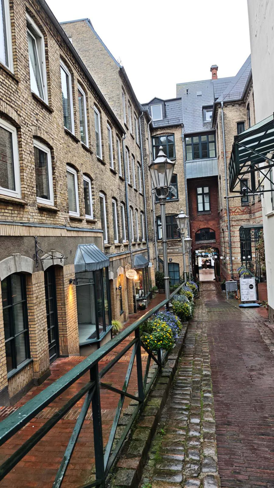
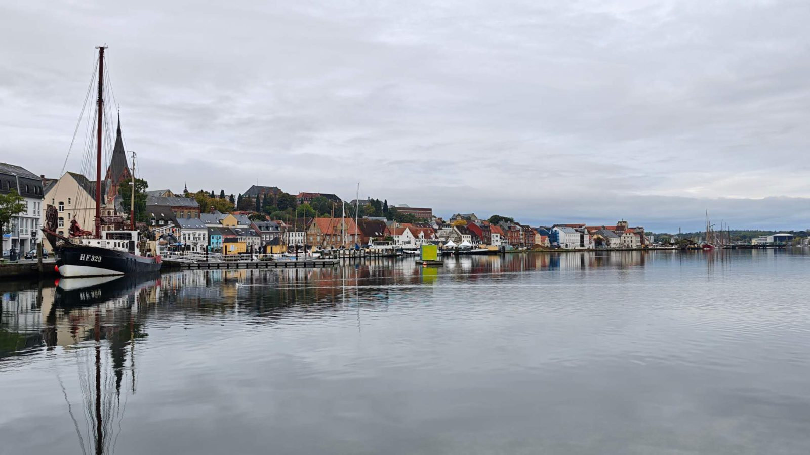
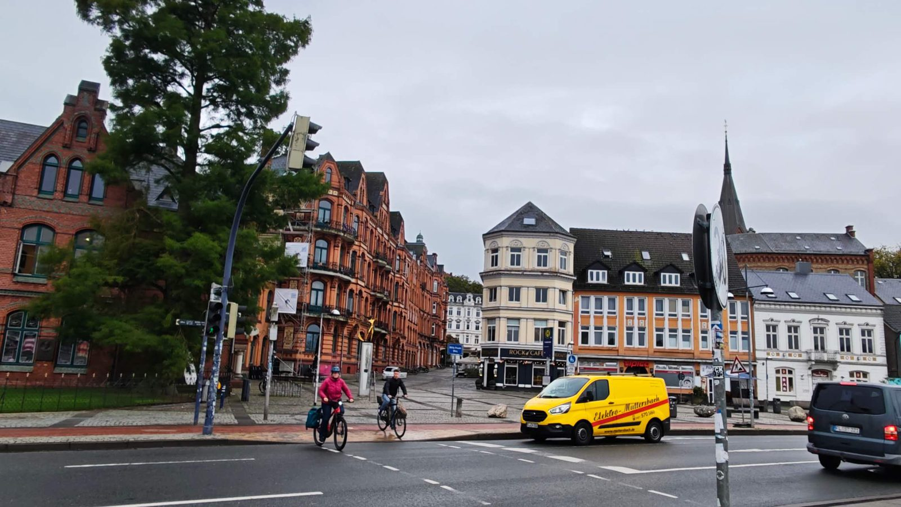
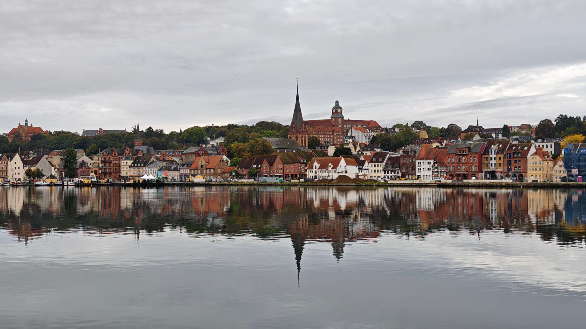

【选帝侯的故事】

【维特尔斯巴赫家族的故事(巴伐利亚和普法尔茨)】

【慕尼黑疯王新天鹅堡】

【狮子亨利的故事，慕尼黑和吕贝克南北双城】

【慕尼黑市政厅的壁钟】

中世纪骑士婚礼，库伯勒舞，鼠疫

【城市历史 · 慕尼黑】

【萨克森的故事】

【欧洲人名的故事】

【北欧房子颜色，石头的故事】
