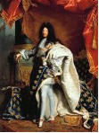
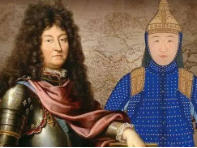

【萨克森的故事】

[**萨克森（Saxony/Sachsen）**](https://www.google.com/search?kgmid=%2Fm%2F070zc)**的历史**是一部跨越千年的地理与政治漂移史。 \[[1](https://baike.baidu.com/item/%E8%90%A8%E5%85%8B%E6%A3%AE%E5%85%AC%E5%9B%BD/6185598)\]

在德国历史上，**“萨克森”这个名字经历过戏剧性的地理大迁移**：最初的“老萨克森”指的是接近北海的德国西北部地区（即今天的下萨克森州）；而今天人们熟知的萨克森州（以德累斯顿和莱比锡为核心），则是中欧历史上的**萨克森选侯国与萨克森王国**，位于德国东部易北河流域。 \[[1](https://visitsaxony.cn/saxony-in-a-nutshell.html), [2](https://baike.baidu.com/item/%E8%90%A8%E5%85%8B%E6%A3%AE%E5%85%AC%E5%9B%BD/6185598), [3](https://baike.baidu.com/item/%E8%90%A8%E5%85%8B%E6%A3%AE%E7%8E%8B%E5%9B%BD/1761559)\]

萨克森的历史脉络可以清晰地划分为以下几个关键时期：

**1. 部落时期与基督教化（3世纪 - 9世纪）**

- **顽强的日耳曼部落**：最初的萨克森人是生活在北海沿岸（今德国西北部）的多个独立日耳曼部落。其中一部分人为了寻找新土地，在5世纪跨越北海迁徙至大不列颠岛，与盎格鲁人融合，成为了英国历史上的“盎格鲁-撒克逊人”。 \[[1](https://zh.wikipedia.org/zh-cn/%E8%90%A8%E5%85%8B%E6%A3%AE%E5%8E%86%E5%8F%B2), [2](https://baike.baidu.com/item/%E8%90%A8%E5%85%8B%E6%A3%AE%E5%85%AC%E5%9B%BD/6185598), [3](https://baike.baidu.com/item/%E7%9B%8E%E6%A0%BC%E9%B2%81-%E6%92%92%E5%85%8B%E9%80%8A%E4%BA%BA/8591707)\]
- **三十年萨克森战争**：留在欧洲大陆的萨克森人极其顽强。法兰克王国的查理曼大帝花了30余年时间（公元772–804年）发起“萨克森战争”，才最终征服了这片土地，并强迫萨克森人皈依基督教，将其正式并入卡洛林帝国的版图。 \[[1](https://zh.wikipedia.org/zh-tw/%E8%90%A8%E5%85%8B%E6%A3%AE%E5%85%AC%E5%9B%BD), [2](https://baike.baidu.com/item/%E8%90%A8%E5%85%8B%E6%A3%AE%E5%85%AC%E5%9B%BD/6185598)\]

**2. 部落公国与奥托帝国（9世纪 - 12世纪）**

- **帝国的核心**：公元843年《凡尔登条约》签订后，帝国分裂，萨克森公国成为东法兰克王国（后来的德意志王国）的五大部族公国之一。
- **萨克森王朝的辉煌**：公元919年，萨克森公爵“捕鸟者”亨利一世被推举为德意志国王，开创了**萨克森王朝**。其子**奥托大帝**（奥托一世）在公元962年加冕为神圣罗马帝国皇帝，萨克森自此成为神圣罗马帝国的开国龙兴之地。 \[[1](https://zh.wikipedia.org/zh-cn/%E8%90%A8%E5%85%8B%E6%A3%AE%E5%8E%86%E5%8F%B2), [2](https://baike.baidu.com/item/%E8%90%A8%E5%85%8B%E6%A3%AE%E5%85%AC%E5%9B%BD/6185598), [3](https://zh.wikipedia.org/zh-tw/%E8%90%A8%E5%85%8B%E6%A3%AE%E5%85%AC%E5%9B%BD)\]

**3. 韦廷家族的统治与地理漂移（12世纪 - 18世纪）**

- **狮子亨利的倒台**：公元1180年，实力过强的萨克森公爵“狮子亨利”被皇帝废黜，强大的萨克森部落公国被肢解，其原本在德国西北部的核心领土被剥离。 \[[1](https://zh.wikipedia.org/zh-cn/%E8%90%A8%E5%85%8B%E6%A3%AE%E5%85%AC%E5%9B%BD)\]
- **向东迁移与选帝侯地位**：经过一系列分封与领土演变，“萨克森”的名称随着统治头衔逐步向东南方向移到了易北河上游。公元1423年，**韦廷家族（Wettin）**入主这片土地并获得了“选帝侯”头衔（拥有选举神圣罗马帝国皇帝的权利），开启了该家族对萨克森长达800多年的统治。 \[[1](https://visitsaxony.cn/saxony-in-a-nutshell.html), [2](https://baike.baidu.com/item/%E8%90%A8%E5%85%8B%E6%A3%AE%E5%85%AC%E5%9B%BD/6185598)\]
- **巴洛克的黄金时代**：17世纪末至18世纪初，萨克森迎来了历史上最耀眼的君主——**“强者”奥古斯特**（Augustus the Strong）。他同时兼任波兰国王，在首府**德累斯顿**大兴土木（修筑茨温格宫、圣母教堂），将其改造为欧洲著名的巴洛克艺术与文化堡垒，史称“易北河畔的佛罗伦萨”。同时，萨克森在此期间还破解了中国瓷器的秘密，建立了欧洲首家硬瓷厂——著名的 [迈森瓷器](https://visitsaxony.cn/saxony-in-a-nutshell.html)。 \[[1](https://www.alange-soehne.com/hk-sc/manufacture/heritage/saxony-under-augustus-the-strong), [2](https://visitsaxony.cn/saxony-in-a-nutshell.html)\]

**4. 战火、王国与帝国成员（19世纪 - 20世纪初）**

- **萨克森王国**：拿破仑战争期间，萨克森选择与拿破仑结盟。1806年耶拿战役后，在拿破仑的支持下，萨克森选侯国正式升格为**萨克森王国**。
- **普鲁士的惩罚**：拿破仑战败后，在1815年的维也纳会议上，作为“站错队”的惩罚，萨克森王国被迫将其**五分之二的领土**割让给普鲁士。1871年，萨克森王国作为邦国加入了普鲁士主导统一的德意志帝国。 \[[1](https://baike.baidu.com/item/%E8%90%A8%E5%85%8B%E6%A3%AE%E7%8E%8B%E5%9B%BD/1761559), [2](https://www.wikiwand.com/zh-mo/%E8%96%A9%E5%85%8B%E6%A3%AE%E7%8E%8B%E5%9C%8B)\]

**5. 现代的萨克森（1918年至今）**

- 1918年第一次世界大战结束，德国君主制垮台，末代国王退位，萨克森改制为魏玛共和国下的[**萨克森自由州**](https://www.google.com/search?kgmid=%2Fm%2F070zc)。
- 二战末期，首府德累斯顿遭受了盟军毁灭性的地毯式大轰炸。战后，萨克森被划入苏联占领区，成为**东德（德意志民主共和国）**工业最发达的地区。
- **两德统一与科技重生**：1990年两德统一后，[<u>萨克森自由州</u>](https://www.google.com/search?kgmid=%2Fm%2F070zc)获得重建。凭借深厚的工业底蕴和微电子产业的布局，现代萨克森（尤其是德累斯顿周边）已转型为全欧洲最重要的半导体与芯片制造基地之一，被誉为**“萨克森硅谷”（Silicon Saxony）**。 \[[1](https://zh.wikipedia.org/wiki/%E8%90%A8%E5%85%8B%E9%81%9C), [2](https://baike.baidu.com/item/%E8%90%A8%E5%85%8B%E6%A3%AE%E7%8E%8B%E5%9B%BD/1761559)\]

萨克森的历史线索非常宏大，如果你想深入了解某个片段，请告诉我：

- 萨克森王朝的**奥托大帝**是如何统一德意志的？
- **“强者”奥古斯特**与巴洛克艺术时期的奢华故事？
- 现代德累斯顿如何从废墟重建并成为**欧洲科技与半导体核心**的？

**“强者”奥古斯特绝对是法国国王**[**路易十四**](https://www.google.com/search?kgmid=%2Fm%2F04pwg&q=%E8%B7%AF%E6%98%93%E5%8D%81%E5%9B%9B)**的狂热崇拜者与追随者**。他不仅在政治上渴望模仿路易十四的专制君主形象，在生活品味和城市建设上更是将路易十四视为终生偶像。 \[[1](https://zh.wikipedia.org/zh-tw/%E5%A5%A5%E5%8F%A4%E6%96%AF%E7%89%B9%E4%BA%8C%E4%B8%96_(%E6%B3%A2%E5%85%B0)), [2](https://baike.baidu.com/item/%E5%A5%A5%E5%8F%A4%E6%96%AF%E7%89%B9%E4%BA%8C%E4%B8%96/3799082), [3](https://visitsaxony.cn/famous-brands/august-the-strong.html)\]

奥古斯特对路易十四的崇拜与效仿主要体现在以下几个方面：

- **震撼心灵的年轻之旅**：在奥古斯特年轻时（1687年至1689年间），他尚未继承萨克森选侯之位。他在漫游欧洲期间造访了法王路易十四的凡尔赛宫。凡尔赛宫那无与伦比的奢华排场、宏伟的巴洛克建筑，以及路易十四至高无上的绝对王权，给这位年轻的萨克森王子留下了刻骨铭心的印象。\[ [1](https://visitsaxony.cn/famous-brands/august-the-strong.html), [2](https://zh.wikipedia.org/zh-tw/%E5%A5%A5%E5%8F%A4%E6%96%AF%E7%89%B9%E4%BA%8C%E4%B8%96_(%E6%B3%A2%E5%85%B0))\]
- **打造“萨克森的凡尔赛”**：回到萨克森执政后，奥古斯特几乎是全面复制凡尔赛宫的模式来改造首府德累斯顿。他修建了极尽奢华的 [茨温格宫](https://visitsaxony.cn/famous-brands/august-the-strong.html)、扩建了德累斯顿王宫，并建立起全欧洲最顶级的珍宝馆“绿穹顶”。他甚至在格罗斯塞德利茨（Großsedlitz）规划了一座规模宏大的“萨克森凡尔赛花园”。 \[[1](https://pinnable.eu/article/court-of-augustus-the-strong), [2](https://visitsaxony.cn/famous-brands/august-the-strong.html), [3](https://news.sina.cn/2017-11-20/detail-ifynwxum6507014.d.html?vt=4)\]
- **君主形象与情妇政治**：路易十四自称“太阳王”，奥古斯特便将自己包装为“萨克森的海克力斯”（大力神），热衷于在宫廷宴会上表演徒手折断马蹄铁来彰显神力。同时，他也模仿法国宫廷的风气，供养了大量的情妇，并举办动辄持续数月的奢华巴洛克狂欢宴会。 \[[1](https://www.alange-soehne.com/us-en/manufacture/heritage/saxony-under-augustus-the-strong), [2](https://baike.baidu.com/item/%E5%A5%A5%E5%8F%A4%E6%96%AF%E7%89%B9%E4%BA%8C%E4%B8%96/3799082), [3](https://artsandculture.google.com/entity/augustus-ii-the-strong/m01ktmq?hl=en)\]
- **绝对君主制的追求**：在政治体制上，奥古斯特一生都在努力压制国内的贵族与等级议会，试图在萨克森建立像法国那样高度中央集权的“绝对君主制”。 \[[1](https://baike.baidu.com/item/%E5%A5%A5%E5%8F%A4%E6%96%AF%E7%89%B9%E4%BA%8C%E4%B8%96/3799082), [2](https://zh.wikipedia.org/zh-tw/%E5%A5%A5%E5%8F%A4%E6%96%AF%E7%89%B9%E4%BA%8C%E4%B8%96_(%E6%B3%A2%E5%85%B0))\]

伏尔泰曾评价说，奥古斯特治下的德累斯顿宫廷，“其奢华与璀璨程度在全欧洲仅次于路易十四的凡尔赛”
